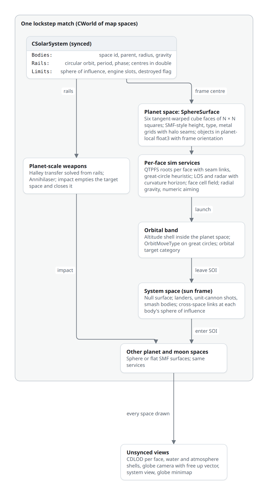

# Planetary Annihilation-style planets

> Status: proposed, not implemented · 2026-10-11

Spherical planets in Recoil, built on [map spaces](spaces.md): each planet or moon is a map space whose surface is a `SphereSurface`, and the whole solar system runs in one lockstep simulation.

| Layer | Design |
|---|---|
| Surface | Cube-sphere: six faces of N × N squares under a tangent-warped projection; each face keeps SMF-style height, type, metal and blocking grids with a halo of the neighbouring faces; craters and terraform stay grid edits |
| Coordinates | Body centres in double in a sun frame; everything on or near a planet in planet-local `float3`; surface coordinates `(face, u, v)`; local up is radial |
| Orientation | Units carry a full frame (`frontdir`, `rightdir`, `updir`) moved by parallel transport; the 16-bit `heading` becomes a derived value relative to the face grid |
| Movement | `GroundMoveType` in the local tangent plane, slopes against radial up, radial gravity; aircraft and orbit as altitude bands above the radius |
| Pathing | QTPFS: root nodes per face, neighbour caches stitched across the 12 seams, great-circle heuristic |
| Sensors | LOS and radar grids per face; elevation-angle raycasts in 3D so the horizon comes from curvature |
| Spatial index | A face cell field per planet (columns over surface cells); the system space between planets uses the sparse index of the space foundation |
| Weapons | Radial inverse-square gravity per planet; ballistic aim solved numerically in the plane through the planet centre with the projectile integrator itself |
| Solar system | `CSolarSystem`: bodies on circular rails evaluated from the frame number; orbital layer inside each planet space; transit through a system space linked at each sphere of influence |
| Rendering | CDLOD quadtree per face, water and atmosphere shells, globe camera with a free up vector, continuous zoom to a system view |
| APIs | Planet-local 3D positions plus space id; sphere helpers for surface points, local up, face coordinates and geodesics |



The generic parts (a `CWorld` owning `CMapSpace` instances, the space id on every world object, per-space ground, QuadField, LOS and pathing instances, cross-space links, space-aware APIs, and the migration that first proves one flat space behaviour-identical) are in [map spaces](spaces.md). This page covers what a sphere adds.

## Surface representation

### Cube-sphere projection

A point on face `f` has face coordinates `s, t ∈ [−1, 1]`; the face basis `(Rf, Uf, Nf)` comes from a fixed table of six axis-aligned faces. Grid cell `(i, j)` covers `s ∈ [−1 + 2i/N, −1 + 2(i+1)/N]`.

| Projection | Forward (face → direction) | Inverse | Cell area max / min | Note |
|---|---|---|---|---|
| Gnomonic (plain cube) | `normalize(Rf·s + Uf·t + Nf)` | `s = d·Rf / d·Nf` | 5.20 | Cells near corners are a fifth of centre cells |
| **Tangent warp (chosen)** | `normalize(Rf·tan(πs/4) + Uf·tan(πt/4) + Nf)` | `s = (4/π)·atan(d·Rf / d·Nf)` | 1.41 | Near-square cells; one `tan` / `atan` per axis |
| S2 quadratic | Piecewise quadratic in `s` | Square root | 2.08 | No trigonometry; fallback if `atan` cost shows in profiles |
| Equal-area (COBE quadrilateralised cube, Lambert-based variants) | Closed-form, longer | Iterative or series | 1.00 | Cells are sheared rhombi near the diagonals: footprints and pathing grids distort |

Area ratios from [S2 `s2coords.h`](https://github.com/google/s2geometry/blob/master/src/s2/s2coords.h); comparison of cube-to-sphere maps in [Zucker and Higashi, JCGT 2018](https://jcgt.org/published/0007/02/01/). Synced code uses streflop's `math::tan` / `math::atan` (`rts/lib/streflop/streflop_cond.h`), which are deterministic across platforms. Stage 0 benchmarks direction → cell for the tangent and quadratic warps; the quadratic warp replaces the tangent one only if `atan` cost is measurable in a synced frame.

### Face grids

```text
SphereSurface                  // the space's surface implementation
  radius, seaRadius, minRadius, maxRadius
  N                            // squares per face side, multiple of 128
  FaceGrid   faces[6]
  CubeEdge   edges[12]         // faceA, sideA, faceB, sideB, reversed
  CubeCorner corners[8]        // three (face, corner) pairs

FaceGrid                       // SMF layouts, side N + 2H with halo H
  cornerHeights[3]             // synced, unsynced, original; above radius
  centerHeights, maxHeights, mips
  slopeMap                     // 1 − dot(normal, radialUp), half res
  normals                      // planet-local
  typeMap, metalMap            // half resolution, as SMF
  blockingCells                // CGroundBlockingObjectMap layout
```

- **Seams.** Each face stores a halo of `H` cells copied from its neighbours through `edges[]` (index remap: rotation by a multiple of 90° and an optional flip). Samplers never cross a face; any write within `H` of an edge (crater, terraform, building) re-copies the halo strip of the neighbour. Corner vertices are owned by the lowest face index and copied to the other two, so all three faces hold bitwise-identical heights there.
- **Heights are radial**: a sample is the height above `radius` along the direction of its cell. Ground position: `centre + dir(f, s, t)·(radius + h)`.
- **Slope** is measured against radial up, precomputed in `slopeMap` on every `UpdateHeightMapSynced`, so `MoveMath::GroundSpeedMod` and MoveDef `maxSlope` read the same field as today.
- **Deformation.** `CBasicMapDamage::Explosion` becomes a crater stamp over cells whose 3D chord distance to the impact is within the radius, on every face the cap touches (one to three); each touched face gets its own `UpdateHeightMapSynced(rect)`, `losHandler->UpdateHeightMapSynced(rect)` and `pathManager->TerrainChange(rect)` with the face id. Terraform (`SetHeightMapFunc`) gets a face-indexed variant.
- **Overhangs, arches, caves** are not in the height grid. They are features (meshes with collision volumes) placed on the surface; cave networks are out of scope.

### Grid against PA's CSG mesh

| | Cube-sphere grid (chosen) | PA: noise-distorted closed mesh plus CSG brushes |
|---|---|---|
| Authoring | Heightmap images per face; SMF tools, converters, procedural noise | Brush libraries and biome rules; custom tools |
| Deformation | `O(cells)` synced writes, already deterministic | Async plate rebuilds; timing must be made synced |
| Pathing, LOS, blocking | Reuse QTPFS, `CLosMap`, `CGroundBlockingObjectMap` on faces | Navmesh, mesh raycasts, new blocking |
| Shape | Height field only; sharp cliffs limited by resolution | Overhangs, arches, hard edges, multi-level terrain (Titans) |
| Look | Uniform cell density; detail from texturing and features | Unique silhouettes per brush |
| Memory | Dense per square, predictable (table below) | Proportional to mesh detail |

The grid keeps every grid-based sim system and the existing map pipeline; PA's mesh would buy overhangs and multi-level chokes at the cost of a new navigation, sensor and deformation stack.

### Planet sizes

Equal area to a flat map gives `radius ≈ 8·N·√(6 / 4π) ≈ 5.53·N` elmos. Memory uses the SMF figure of about 180 B per square from [multiple map spaces](spaces.md#memory) (calculated, not measured; QTPFS adds a byte per square per MoveDef). Halos add under 1 % at these sizes.

| N | Squares (6N²) | Same area as a flat map of | Radius (elmos) | Circumference (elmos) | RAM at 180 B / square |
|---:|---:|---|---:|---:|---:|
| 256 | 393 216 | 9.8 × 9.8 | 1 416 | 8 890 | 71 MB |
| 512 | 1 572 864 | 19.6 × 19.6 | 2 830 | 17 780 | 283 MB |
| 768 | 3 538 944 | 29.4 × 29.4 | 4 250 | 26 680 | 637 MB |
| 1024 | 6 291 456 | 39.2 × 39.2 | 5 660 | 35 570 | 1.13 GB |

Curvature is a gameplay quantity at these sizes. An eye `h` elmos above a smooth sphere sees the surface to `√(2·radius·h)`: 412 elmos at `h = 30` on N = 512. Over 1000 elmos the surface drops `d² / 2R` = 177 elmos below the tangent plane. LOS, radar and artillery ranges of Zero-K and BAR are in that range, so planet size tunes both.

A system of two N = 512 planets and an N = 256 moon holds 3.5 M squares, about 640 MB in the SMF layout. A slimmer planet layout (normals derived from heights instead of stored synced and unsynced, sparse blocking cells instead of 72 B per square) is open question 3.

## Coordinates and frames

| Frame | Holds | Type | Precision |
|---|---|---|---|
| Sun frame | Body centres and velocities, system-space objects | Body state in `double`; system-space object positions in `float3` | `double` for centres; `float` ulp 0.06 elmo at 10⁶ elmos for objects in transit |
| Planet-local frame | Every unit, feature, projectile and effect of a planet space, orbital band included | `float3` relative to the body centre, axes fixed (planets translate, do not spin) | ulp 0.0005 elmo inside 8192 elmos |
| Surface coordinates | Grid lookups | `SurfacePos { face, s, t }` or cell `(face, i, j)` | Exact cell indices |
| Tangent frame at `p` | Movement, facing, aiming | `up = normalize(p)`, tangents from the object's frame | — |

A planet frame moves with the body on its rail, so it is in free fall around the sun; leaving out the sun's gravity inside it is consistent. Objects never hold sun-frame positions while they belong to a planet space; a link transfer adds `centreA − centreB` in `double` and rounds once.

Conversions on `SphereSurface`:

| Function | Definition |
|---|---|
| `Up(p)` | `p / ‖p‖` |
| `ToSurface(p) → (face, s, t)` | Face of the largest-magnitude component of `p`; `s, t` by the inverse warp |
| `FromSurface(face, s, t, h) → p` | `dir(face, s, t)·(radius + h)` |
| `HeightAt(p)` | Bilinear over the face's corner heights at `ToSurface(p)` |
| `Altitude(p)` | `‖p‖ − radius − HeightAt(p)` |
| `Geodesic(a, b)` | `radius · 2·asin(‖â − b̂‖ / 2)` |
| `Tangent(p, v)` | `v − Up(p)·dot(v, Up(p))` (replaces the `.y = 0` projections; `GroundMoveType.cpp` alone has 45 horizontal projections) |

### Orientation

| Today | On a sphere |
|---|---|
| `SyncedSshort heading` is the source of facing; `UpdateDirVectors` builds `frontdir` from it and tilts by a quaternion from `UpVector` to the ground normal (`rts/Sim/Objects/SolidObject.cpp`) | `frontdir`, `rightdir`, `updir` (already `SyncedFloat3` members) are the source |
| Turning: `heading += delta` | Rotate `frontdir` about `Up(pos)` by the turn angle |
| Moving: heading unchanged | **Parallel transport**: after each move, rotate the frame by the shortest-arc quaternion from the old to the new radial up (the quaternion `UpdateDirVectors` already builds, with `UpVector` replaced by the old up); re-orthonormalise with up as the primary axis |
| Ground tilt from `GetWantedUpDir` blending `UpVector` with the ground normal | Blend radial up with the ground normal |
| `heading` read by scripts, APIs, `GetHeadingFromVector` (54 uses) | Derived: angle of `frontdir` in the tangent plane against the face's `Uf` axis projected onto it. Continuous inside a face; jumps by a multiple of 90° at seams, the same turn the face grid makes |
| `buildFacing` (108 matches) | Unchanged meaning: one of four facings relative to the face grid at the footprint |

Parallel transport has no pole: there is no latitude or longitude anywhere in the sim.

## Surface interface: what the sphere needs

[Map spaces](spaces.md) put ground queries, bounds and per-space services behind a per-space surface interface. The sphere needs these operations in that interface; the flat SMF implementation answers them with today's code.

| Operation | Flat SMF | Sphere |
|---|---|---|
| `Up(p)` | `UpVector` | `normalize(p)` |
| `HeightAt(p)`, `Normal(p)`, `Slope(p)` | `CGround::GetHeightReal(x, z)`, `GetNormal`, `GetSlope` | Face lookup by `ToSurface(p)` |
| `Altitude(p)` | `p.y − height` | `‖p‖ − radius − height` |
| `Gravity(p)` | `(0, mapInfo->map.gravity, 0)` | `−Up(p) · g·(R/‖p‖)²` |
| `WaterLevel` | `GetWaterPlaneLevel()` = 0 | `seaRadius` |
| `LineCollision(from, to)` | `CGround::LineGroundCol` | March in steps of half a cell against `‖p‖ − radius − h`, bisection refine |
| `Clamp(p)`, `InBounds(p)` | `ClampInBounds`, `IsInBounds` (94 matches) | No edges: identity; altitude cap for the band |
| `Tangent(p, v)`, `PlanarDistance(a, b)` | `v.y = 0`, `Distance2D` (240 matches of 2D helpers) | `Tangent`, `Geodesic` |
| `CellOf(p)`, `ForEachCellInCap(p, r, fn)` | Square index, rectangle loop | `(face, i, j)`, flood fill over cells with seam remap |
| `TerrainChanged(face, rect)` | Rectangle | Rectangle on one face, halo copied |

## Ground movement

| `GroundMoveType` step | Sphere change |
|---|---|
| Waypoint direction | `Tangent(pos, waypoint − pos)`, normalised |
| `ChangeHeading` | Rotation of `frontdir` about `Up(pos)` toward the wanted tangent direction at `turnRate` |
| Speed modifiers | `CMoveMath::GetPosSpeedMod` reads the face's slope and type maps; directional slope uses `dot(dir, normal)` in 3D |
| `UpdateOwnerPos` | `p' = p + v·dt`, then reproject: `p'' = Up(p')·(radius + HeightAt(p'))`, then parallel transport of the frame |
| Skid, impulse, falling | Integrate with `Gravity(p)`; landed when `Altitude ≤ 0` |
| Unit and feature collisions | 3D separation as today; push-out vectors through `Tangent` instead of zeroed `y` |
| Static blocking | `CGroundBlockingObjectMap` per face; footprints placed in face cells; cells across an edge through `edges[]` |
| Footprints near corners | Cells meeting at the 8 cube corners are rhombi of 120°; footprints may not cover a cube corner vertex (exclusion radius in cells per planet) |
| Map edge | None |

| Move type | Sphere change |
|---|---|
| `AAirMoveType`, `HoverAirMoveType`, `StrafeAirMoveType` | Wanted height is altitude along radial up; banking and pitch in the tangent frame |
| `ScriptMoveType` | `gravityFactor` applies `Gravity(p)`; `trackGround` uses `Altitude` |
| New `OrbitMoveType` | Holds `‖p‖ = seaRadius + orbitAltitude`; moves along great circles at constant speed; no gravity integration; turn and stop like hover aircraft |
| Ships, hovers | Float at `seaRadius`; depth `seaRadius − ‖p_ground‖` |

## Pathfinding

| Option | Fit |
|---|---|
| **QTPFS per face, stitched (chosen)** | Reuses MoveDefs, speed-mod bins, incremental `TerrainChange` repair, path cache, shared paths, worker threads. `NodeLayer` already holds a grid of root nodes (`xRootNodes × zRootNodes`, `GetRootNode`); faces become root blocks |
| PA-style navmesh with flow fields | Needed for overhangs and caves, which the grid does not have; a new pathfinder and repair path |
| Flow-field tiles on face sectors (sector A\* plus per-sector integration fields, Game AI Pro ch. 23) | Strong for planet-wide moves of large groups, PA's worst case; an addition on the same face grids, after QTPFS works |

QTPFS on the sphere:

- **Layout.** One `NodeLayer` per MoveDef over a 6-face index space; `rootNodeSize` divides N, so no root spans a face. `NodeLayer::MapSquareData` speed bins fill per face from `slopeMap` and `typeMap`.
- **Seam neighbours.** `QTNode::UpdateNeighborCache` looks up nodes along a face edge through `edges[]`, with the index rotation applied; `NeighbourPoints` (edge transition points, `float2`) stay in the owning face's coordinates and convert to planet-local `float3` for costs.
- **Costs.** Edge cost is the 3D distance between transition points times the speed-mod factor (chord and arc differ by under 0.2 % for nodes up to 64 squares on N = 512).
- **Heuristic.** `minRadius · 2·asin(‖â − ĝ‖ / 2)` (great-circle distance on the lowest surface) times `hCostMult`: admissible, symmetric, so `PathSearch`'s bidirectional join is unchanged.
- **Smoothing.** `PathSearch::SmoothPath` works in one face's `(s, t)`; across an edge it unfolds the neighbour face into the current face's plane; it does not smooth through nodes touching a cube corner (three faces meet at 270°, no flat unfolding).
- **Repair.** `TerrainChange(face, rect)`; changes within the halo also dirty the neighbour face's edge nodes.
- **Moving planets.** Paths are planet-local; rails do not touch them.

## LOS, radar and sensors

| Part | Design |
|---|---|
| Grids | `CLosMap` per face at the LOS mip, with halo; `losHandler->InLos(p)` reads the cell of `ToSurface(p)` |
| Raycast fast path | Instance fully inside one face (radius below the distance to every edge): today's `CLosMap::AddRaycast` over precomputed ray squares, with each square's comparison done as an **elevation angle**, `dot(q − eye, Up(eye)) / ‖Tangent(eye, q − eye)‖`, using a cached planet-local position per LOS cell; the curvature horizon follows |
| Seam and corner path | Great-circle ray march: rays fan out in the eye's tangent plane, each step rotates the direction by `step / radius`, samples `HeightAt`, keeps the maximum elevation angle; cells written to their owning face |
| Caching | `SLosInstance` hashing (`GetHashNum`) keyed by face and cell, as today by square |
| Radar, sonar, jammers | Same grids and raycasts; radar gets the horizon of `radarEmitHeight`; a radar satellite in the orbital band sees a cap of half-angle `acos(R / (R + altitude))` |
| Airborne and orbital targets | Visible when their surface cell is in LOS, as aircraft today; the orbital band adds its own sensor category (open question 6) |

## Spatial index

`CQuadField` is a 2D grid of columns in `x, z` with per-allyteam lists (`QuadStore`). On a sphere the same columns stand over surface cells: a **face cell field** of `6 × (N / quadSize)²` columns per planet space.

| Query | Sphere implementation |
|---|---|
| `GetQuads(pos, radius)` | Cell of `ToSurface(pos)`, then breadth-first over the cell graph (seams through `edges[]`) keeping cells whose bounding cap intersects the query sphere |
| `GetQuadsRectangle` | Not meaningful on a sphere; callers move to caps |
| `GetQuadsOnRay`, `GetQuadsOnWideRay` | Step the 3D segment at half a column, collect `ToSurface` cells (widened by the ray width) |
| `WorldPosToQuadField` | `ToSurface` and cell index |
| Orbital band | Same columns: altitude is ignored as `y` is today |

The system space between planets uses the sparse index of [map spaces](spaces.md) for null-surface spaces.

## Ballistics and weapons

| Part | Today | Sphere |
|---|---|---|
| Gravity | `speed + UpVector * mygravity` in `CProjectile::Update` (`rts/Sim/Projectiles/Projectile.cpp`) | `speed + Gravity(pos)`: inverse-square toward the planet centre, weapon `myGravity` scales it |
| Ground hit | `CProjectileHandler::CheckGroundCollisions` reads `CGround::GetHeightReal(px, pz)` | `Altitude(pos) ≤ 0` |
| Aim | `CCannon::GetWantedDir` solves a flat parabola in closed form | Numerical solve below |
| Terrain check | `CGround::TrajectoryGroundCol` with parabola coefficients | Step the solved trajectory against `Altitude`, as `SimTrajectoryGroundColDist` steps a trajectory today |
| Target leading | Flight time from the parabola | Flight time from the solve |

**Aiming solver.** Under a central force the trajectory stays in the plane through the planet centre, the launch point and the launch velocity; to hit a target that plane must contain the target. The azimuth is fixed by that plane and only the elevation `θ` (or the speed, for fixed-angle weapons) is unknown:

1. Work in 2D in that plane.
2. Initial guess: `GetWantedDir`'s closed form in the launch point's tangent frame.
3. `miss(θ)` = signed angle between where the trajectory, stepped with the projectile's own discrete integrator, crosses the target's radius, and the target's direction.
4. Root by the Illinois method (regula falsi with halving) over the low bracket, or the high bracket for `highTrajectory`.
5. Warm start from the weapon's previous solution; targets move little per frame.

Using the projectile's integrator as the predictor makes the solve match the flight exactly and keeps it deterministic. Short shots converge in one or two iterations from the flat guess; long shots over a horizon need more. Stage 4 measures iterations and cost per aim.

Missiles, beam lasers, lightning, flame and torpedoes need no solver: their motion is already 3D; `BeamLaser` and LOS-type weapons gain a curvature check through `LineCollision`.

**Interplanetary shots.** A projectile reaching a body's sphere of influence crosses into the system space; there it follows a transfer arc (cubic Hermite in the sun frame from departure to the target body's rail position at arrival time) instead of free n-body flight, and is interceptable. On entering the target's sphere of influence it is handed to that planet space. PA's Unit Cannon uses the same path with a unit as payload.

## Water and atmosphere

| Part | Design |
|---|---|
| Sea | A sphere at `seaRadius` per planet; `WaterLevel` per space; depth and floating against it; `voidWater` per planet |
| Water rendering | A water shell drawn with the CDLOD grid at `seaRadius`; reflections from the environment cube map and screen space, since planar reflection (`rts/Rendering/Env/*Water.cpp`) assumes a plane |
| Atmosphere | Precomputed-LUT sky and aerial perspective of [Hillaire 2020](https://sebh.github.io/publications/egsr2020.pdf), per planet parameters, valid from the surface and from space |
| Sun | Direction per planet from its centre to the sun in the sun frame; day and night sides as planets move along rails |
| Fog | Per-planet fog from the atmosphere model |

## Rendering

| Part | Design |
|---|---|
| Terrain LOD | **CDLOD** ([Strugar 2009](https://github.com/fstrugar/CDLOD)): a quadtree per face, one instanced grid patch per node, vertex morphing between levels by camera distance, no stitching inside a face |
| Vertex shader | Patch `(s, t)` → tangent warp → direction → `radius + h` from a 6-layer height texture array (R32F, halo included) |
| Seams | Vertices on face edges evaluated from the canonical owner face's `(s, t)` so neighbouring faces produce identical positions; morph ranges aligned across faces; skirts as fallback |
| Precision | Camera-relative: patch origins subtracted from the camera position in `double` on the CPU; reversed-Z depth with a float depth buffer for the range from close zoom to system view ([Reed 2015](https://developer.nvidia.com/content/depth-precision-visualized)) |
| Texturing | Per-face diffuse and splat textures (SMT tiles per face, or a texture array) sampled with halo texels; detail textures triplanar in planet-local space so their pattern is seamless |
| Decals | Projected boxes oriented by the local tangent frame |
| Shadows | Cascaded shadow maps fitted to the view frustum; `rts/Rendering/ShadowHandler.cpp` fits one map over a flat map today |
| Grass, features, units | Per face for grass; models placed by their full frame |
| Icons, command lines, area circles | Surface-following polylines (geodesic arcs) and spherical caps |
| Picking | Mouse ray against the bounding sphere `maxRadius`, then the `LineCollision` march; `TraceRay`/`GuiTraceRay` (`rts/Game/TraceRay.h`) call the space's surface |
| Other planets | Each planet space is drawn when in view; distant planets drop to CDLOD's coarsest levels |

### Camera and views

| View | Design |
|---|---|
| Globe controller (`GlobeController`, new `CCameraController`) | State: planet space, focus direction `f`, tangent heading `t`, distance, pitch. Pan rotates `f` about `f × t` by `screen delta · distance / radius` and transports `t` with the same rotation; zoom changes distance; rotate turns `t` about `f`. Camera up is radial at `f`: no pole lock, no gimbal |
| North-up option | `t` re-aimed toward the planet's pole each frame, disabled within a cap around the poles (PA's pole-lock disorientation is the reason for the cap) |
| `CCamera` | Today Euler `rot` (`rts/Game/Camera.h`: inclination, azimuth, roll); gains a basis setter (`forward`, `up`, `right`) so controllers set orientation directly |
| System view | Continuous zoom-out past a distance threshold: camera orbits the sun frame, planets drawn at coarse LOD, rails as lines, transits and Halley paths drawn |
| Planet switch | Selecting a planet in the system view or a hotkey flies the camera there |
| Minimap | `CGlobeMiniMap`: the current planet as a small rotatable globe with unit icons; click sets the globe camera focus; `CMiniMap` stays for flat spaces |
| Picture-in-picture | A second world render into a viewport; costs a full extra draw pass; after stage 6 |

## Solar system, orbits and transfer

```text
CSolarSystem                         // synced, creg-serialised
  Body bodies[]
    spaceId                          // map space holding the planet surface
    parentBody                       // sun or planet
    radius, surfaceGravity, soiRadius
    Rail { orbitRadius, periodFrames, phase, inclination = 0 }
    state: OnRail | Transfer(path) | Destroyed
  BodyState Evaluate(body, frame)    // double centre and velocity
```

| Decision | Choice | Reason |
|---|---|---|
| Orbits | **Rails**: circular, evaluated from the frame number with streflop `double` trigonometry | Deterministic, free, predictable travel windows; PA matches use circular orbits |
| Planet spin | None | Fixed planet-local axes; spin would make every planet frame rotate (Coriolis on projectiles) for little play |
| Orbital layer | **Inside each planet space** as an altitude band | Orbit-to-ground fire, orbital radar and anti-orbit defences need same-frame queries with the ground |
| Between planets | **One system space** (null surface, sun frame) | Landers, cannon shots and smash bodies are visible and interceptable in flight |
| Space-to-space transfer | Cross-space links of [map spaces](spaces.md) at each body's `soiRadius` | Frame change in `double`: `p_B = p_A + centre_A − centre_B`, velocities relative to the frames |
| Travel | Transfer arcs: cubic Hermite from departure to the target's rail position at arrival; arrival time by fixed-point iteration `T ← distance(p0, target(T)) / speed` | Readable, cheap, matches moving targets |
| Teleporter pairs | Direct link between two planet spaces, both ends built | PA's teleporter |
| Moons after a planet dies | Re-parent to the sun with a rail through the current position and phase | Continuous position |

## Planet-scale weapons

| Weapon | Design |
|---|---|
| Halley smash | Engine-slot structures on a body; when all are built the owner picks a target body and impact direction; the body switches from `OnRail` to `Transfer` along a solved arc; every frame the arc is tested against all bodies (segment–sphere), the first hit wins; every player is told of each engine and of the path |
| Impact | Target space: every object killed in staged batches over frames within the frame budget, surface replaced by a debris state or the space closed ([map spaces](spaces.md) owns space removal); source body destroyed; moons re-railed |
| Annihilaser | Catalyst structures on control points of a metal planet; when armed, a beam to a chosen surface point of a body in range; impact as a smash |
| Crater-scale variant | A smash that rewrites a large cap of height cells instead of destroying the planet (game choice); the rewrite and QTPFS repair are spread over frames |

## Game APIs

Space ids, per-space versions of existing calls and AI callbacks are defined in [map spaces](spaces.md). Sphere-specific additions, in Lua, Wasm and the Skirmish AI interface, planet-local 3D positions throughout:

| Call | Returns |
|---|---|
| `GetPlanetInfo(spaceID)` | Radius, sea radius, min and max radius, face size N, surface gravity, body id |
| `GetBodyState(bodyID [, frame])` | Centre and velocity in the sun frame, rail parameters, state |
| `GetSurfacePoint(spaceID, dx, dy, dz)` | Ground point under a direction |
| `GetSurfaceHeight(spaceID, x, y, z)`, `GetSurfaceNormal`, `GetLocalUp` | Height above radius, normal, radial up |
| `PosToFaceUV(spaceID, x, y, z)`, `FaceUVToPos(spaceID, face, s, t [, h])` | Surface coordinates |
| `GetGeodesicDistance(spaceID, a, b)` | Great-circle distance on the radius |
| `GetUnitFrame(unitID)`, `SetUnitFrame(unitID, front, up)` | Full orientation (`GetUnitVectors` already returns it) |
| `SetSurfaceHeightFunc(spaceID, face, ...)` | Terraform on face cells |
| `GetTransferArc(fromSpace, toSpace)` | Travel time and arc for the current frame |

Flat-only calls (`GetGroundHeight(x, z)`, rectangle queries, map size) raise an error when called for a sphere space (open question 8). In this checkout 107 of 1472 documented Lua functions take a `z` coordinate and 15 take a heading or facing; the Skirmish AI interface exports 47 `Map_*` callbacks.

What a game changes for spherical planets: terrain reads through the sphere calls, horizontal distances and facings through tangent frames, build placement on face cells, start positions as surface points, minimap and camera widgets, area commands as caps, and AI terrain analysis per face.

## Simulation and networking at PA scale

| | PA | Recoil with spheres |
|---|---|---|
| Who simulates | Server only, 10 Hz, clients interpolate keyframed curves ([ChronoCam](https://www.forrestthewoods.com/blog/tech_of_planetary_annihilation_chrono_cam/)) | Every client, all planets, `GAME_SPEED` 30 |
| Overload | Time dilation from server CPU | Speed reduction from the slowest client's CPU |
| Bandwidth | Grows with visible units; ≤ 1 Mbit/s per player target | Commands only |
| Fog | Unseen units never sent | Full state on every client |
| Rewind and PIP | ChronoCam, per-viewpoint server streams | Replays; PIP is a client render |
| Rejoin | Stream current state | Re-simulate from the start |

Cost model per synced frame: units, projectiles and path requests over all spaces; sphere overheads are `ToSurface` per height query, tangent projections, the aiming solve and great-circle LOS rays near seams. Deformation and smash rewrites are spikes spread over frames. Memory follows total squares of all planets. Unit caps are per match: `MAX_UNITS` and `MAX_FEATURES` 32 000 each (`rts/Sim/Misc/GlobalConstants.h`), shared by every planet.

PA's reported limits were sim slowdown in multi-planet battles with thousands of units and pathing cost growing with terrain detail ([performance page](https://wiki.palobby.com/wiki/Planetary_Annihilation_Server_Sim_Performance_/_Time_Dilation_/_RAM_Usage)). A lockstep target is a unit total the weakest supported client simulates in real time, split across planets; stage 7 measures it.

Server-authoritative simulation stays a decision (open question 10): it would remove the client-CPU ceiling and give fog security and rewind, and it would replace `rts/Net` lockstep, the synced/unsynced split, replays and every game's assumption that synced state is local. Nothing in the sphere design depends on either choice.

## Map-making and archives

```text
planet archive (.sdz / .sd7)
  planetinfo.lua      radius, N, seaRadius, gravity, atmosphere, terrain types, generator
  faces/{+x,-x,+y,-y,+z,-z}/
    height.png        16-bit, (N+1)², edges shared with neighbours
    type.png, metal.png, splat.png
    diffuse.dds       or SMT tiles
  features.lua        positions as (face, s, t) or directions
system archive
  system.lua          bodies, rails, planet archives (archive depends), start positions, engine slots
```

| Tool | Purpose |
|---|---|
| `planetgen` | Deterministic generator: 3D noise evaluated on sphere directions (seamless by construction), biomes from noise, brush stamps (craters, mesas, ridges, PA-style) rasterised onto face grids; run offline or at load as the engine already generates blank maps (`rts/Map/Generation`) |
| Equirectangular converter | Lat-long heightmaps (planetary data, other tools) to six faces with shared edges |
| Validator | Seam continuity, corner ownership, memory per planet, metal spots and start positions on the surface |
| Viewer | The globe camera on a loaded planet without a game |

## How Planetary Annihilation does it

| Aspect | PA | Source |
|---|---|---|
| Geometry | Closed base mesh distorted by noise; biome CSG brushes bent onto the sphere add or subtract closed meshes. Cube-sphere heightmaps were rejected for lacking hard edges and overhangs | [Mavor 2013](http://mavorsrants.blogspot.com/2013/02/planetary-annihilation-engine.html); [Chou, Bending Solid Geometry](https://allenchou.net/2013/07/bending-solid-geometry-in-planetary-annihilation/) |
| Deformation | Plates to the planet centre; a new brush rebuilds touched plates asynchronously | Mavor 2013 |
| Texturing | One parameterisation into virtual-texture space, pages generated on demand | Mavor 2013 |
| Navigation | Mesh is the navmesh ("multiple layers, caves"); flow fields on a grid over its parameterisation; more CSG costs more pathing | Mavor 2013; [PA Titans wiki](https://wiki.palobby.com/wiki/Planetary_Annihilation_Titans) |
| Planets | Recommended radius 800–1000 and fewer than 8 planets; `MAX_PLANETS` 16 | [performance page](https://wiki.palobby.com/wiki/Planetary_Annihilation_Server_Sim_Performance_/_Time_Dilation_/_RAM_Usage); [forum guide](https://forums.planetaryannihilation.com/threads/system-editor-elliptical-orbits-and-minimum-planet-size.68469/) |
| Orbits and smash | Circular orbits in matches; Halley engines move a body; impact choice; moons take sun orbits when a planet dies; Annihilaser from five Catalysts | forum guide; [wiki.gg](https://planetaryannihilation.wiki.gg/wiki/Gameplay_Annihilation) |
| Orbit and travel | Orbital layer with its own factory, fabber, fighters and satellites; Astraeus lander, teleporters, Unit Cannon | [PA unit database](https://palobby.com/units/) |
| Camera | Globe camera, optional pole lock with odd angles near poles, system view, PIP | [Steam thread](https://steamcommunity.com/app/386070/discussions/0/5757294878591871701) |
| Network | Server-authoritative 10 Hz with curve streaming and ChronoCam | ChronoCam |
| Reported problems | Multi-planet slowdowns; weak invasions at launch (one-unit landers, quickly killed teleporters), reworked in Titans; pole disorientation | performance page; [Steam](https://steamcommunity.com/app/233250/discussions/0/620703493325179962); [PC Gamer](https://www.pcgamer.com/uk/planetary-annihilation-titans-resurrects-a-flawed-rts-and-its-out-today) |

## Effort and risk

Counts are `grep` matches over `rts/` at `45c811a9` (third-party `rts/lib` excluded). Ground, map and per-space plumbing (`CGround::` 306 in 81 files, `readMap->` 333 in 77, `mapDims.` 736 in 93) is the [map spaces](spaces.md) migration; the table lists the sphere-specific work on top of it.

| Subsystem | Flat assumption (matches / files) | Sphere work | Estimate |
|---|---|---|---|
| Surface math and `SphereSurface` | — | Projection, edge table, face grids with halos, conversions, deformation, loader | 2–3 engineer-months |
| Up and gravity | `UpVector` 201 / 70; `mapInfo->map.gravity` 29 / 17 | `Up(p)`, `Gravity(p)` at each site | 1–2 |
| Orientation | `heading` 254 / 64; `GetHeadingFromVector`, `GetVectorFromHeading` 82 / 20; `buildFacing` 108 / 38 | Frame source of truth, parallel transport, derived heading | 2–3 |
| Horizontal projections | 2D helpers (`XZVector`, `*2D` distances) 240 / 52 | `Tangent`, `Geodesic` | 1 |
| Bounds | `ClampInBounds`, `IsInBounds` and kin 94 / 36 | Identity on spheres | 0.5 |
| Ground movement and air | `rts/Sim/MoveTypes` | Tangent-frame `GroundMoveType`, radial air, `OrbitMoveType` | 2–3 |
| Pathfinding | `pathManager->` 68 / 15 | Face roots, seam neighbours, heuristic, smoothing | 2–3 |
| LOS and radar | `losHandler->` 119 / 38 | Face grids, elevation-angle raycasts, great-circle path | 1–2 |
| Spatial index | `quadField.` 141 / 43 | Face cell field queries | 1 |
| Weapons | `LineGroundCol`, `TrajectoryGroundCol`, `SimTrajectoryGroundColDist` 44 / 20; `Cannon.cpp` | Radial gravity, numerical aim, interplanetary hand-off | 1–2 |
| Water | `GetWaterPlaneLevel` 29 / 11 | Sea radius; water shell renderer | 1–2 |
| Terrain rendering | `rts/Map/SMF` drawers, shadows, decals, grass | CDLOD faces, texturing, CSM, decals, atmosphere | 4–6 |
| Camera, minimap, picking, UI drawing | `rts/Game/Camera`, `MiniMap.cpp`, `TraceRay.cpp` | Globe controller, system view, globe minimap, geodesic drawing | 2–3 |
| Solar system and transfer | — | `CSolarSystem`, system space, links, transfer arcs, smash | 2–3 |
| APIs | 107 Lua functions with `z`, 15 with heading; 47 `Map_*` AI exports | Sphere calls in Lua, Wasm, AI | 1–2 |
| Tools | — | `planetgen`, converter, validator | 1–2 |
| **Total, engine side** | | | **≈ 25–40 engineer-months**, after the map-spaces foundation |

The figures are estimates by subsystem, not measurements. Game content (units, balance, UI, AI) is separate per game.

| Risk | Mitigation |
|---|---|
| Hidden flat assumptions beyond the counted patterns | Sphere debug build asserts on any `UpVector` or `.y`-as-height use in a sphere space; the drive-around test (stage 2) crosses every seam and corner |
| Determinism of new math | Only streflop functions in synced sphere code; stage 0 runs the math on three platforms; the sync verification plan (`rts/wasm/docs/recoil_wasm_sync_verification.md`) gates every stage |
| `ToSurface` and `atan` cost per height query | Cached `(face, s, t)` per object, updated on move; quadratic warp fallback |
| Seam and corner artefacts (paths, footprints, cracks, LOS) | Halos, corner ownership, corner exclusion for footprints, seam test scenarios in every stage |
| Rendering scope (CSM, decals, water, atmosphere) | Unshaded CDLOD first; one renderer at a time with captures at RTS height and close zoom |
| Lockstep ceiling at PA unit counts | Unit-total target measured in stage 7; flow fields for large groups; server-authoritative mode stays an open decision |
| Games must be rewritten for spheres | Flat spaces unchanged for BAR and Zero-K; spheres are opt-in per space; a small test game drives the work |

## Staged plan

Every stage keeps flat spaces behaviour-identical (sync checksums and replays as in `rts/wasm/docs/recoil_wasm_sync_verification.md`) and runs one engine at a time.

| Stage | Build | Go / no-go |
|---|---|---|
| 0. Sphere math, engine-free | Projections, edge table, `ToSurface` / `FromSurface`, halo copy, geodesic, parallel transport, Illinois aim solve in 2D; benchmarks | Round-trip error below a thousandth of a cell; seam positions bitwise equal from both faces; results bitwise identical on amd64-linux, arm64-linux, amd64-windows; direction → cell cost of the tangent and quadratic warps measured, warp chosen |
| 1. Sphere space boots | `SphereSurface` behind the space surface interface, generated planet, deformation, unshaded CDLOD debug renderer, globe camera | Planet renders with no cracks at seams and corners; a crater across a corner updates all three faces; camera pans over both poles without flips |
| 2. Ground units drive | Frames, parallel transport, `GroundMoveType` with raw moves, collisions, blocking on faces | A scripted unit drives a closed loop crossing all 12 edges and 8 corners: no position jumps, no heading flips, frame orthonormal; 200 units collide and stack as on a flat map; no desync over a scripted run |
| 3. Pathing, sensors, index | QTPFS faces, LOS and radar, face cell field | Paths across seams within a few percent of the geodesic optimum on open terrain; LOS cells match a brute-force 3D reference at the horizon; repair after craters on seams; frame time against a flat map of equal area with the same units |
| 4. Weapons | Radial gravity, aim solver, terrain checks, beam curvature | Hit rates at matched ranges against a flat map; solver iterations and time per aim within budget; shells over the horizon land on target |
| 5. One-planet skirmish | Test game (Lua or Wasm): build, economy, armies, AI on one sphere | Playable from start to win; a playtest shows flanking around the curve and horizon play; captures at RTS height and close zoom |
| 6. Planet look | Texturing, water shell, atmosphere, CSM, decals, grass, globe minimap, picking | Native captures pass review at both zooms; frame time at RTS height against the flat renderer |
| 7. Solar system | `CSolarSystem`, several planet spaces, orbital band, system space, landers, teleporters, unit cannon | Transfers keep orders, selection and LOS rules; frame time of N planets against one planet with the same unit total; memory against the size table; unit-total target set from the weakest supported client |
| 8. Planet-scale weapons | Halley smash, Annihilaser, destruction, moons re-railed | Impact frames within budget over the staged batches; no orphaned units, transfers or commands; replays of a smashed system stay in sync |
| 9. APIs, AI, tools | Sphere calls in Lua, Wasm and AI; `planetgen`, converter, validator | A game ships a system built only with the tools; an AI plays a multi-planet match through orbit with readable intent |

**Early gameplay test.** Solar-system rules (rails, orbital band, transit, smash) do not depend on the surface. With [map spaces](spaces.md) in place, stage 7's rules can run first on flat SMF planet spaces while stages 1–6 build the sphere, so the multi-planet play is tested early; the flat planets are a prototype and a fallback, replaced by sphere spaces as they pass stage 5.

Stop points: after stage 2 if seams and corners cannot be made invisible to movement; after stage 3 if sphere pathing and LOS cost well above a flat map of equal area; after stage 7 if a few planets at game-typical army sizes run below real time on the weakest supported client (then open question 10 comes up).

## Open questions

| # | Question | Options | Suggestion |
|---|---|---|---|
| 1 | Projection | Tangent warp / S2 quadratic / equal-area | Tangent, unless stage 0 shows `atan` cost |
| 2 | Planet sizes | Range of N per body class | N = 256 moons to N = 768 large planets, checked against memory |
| 3 | Planet memory layout | SMF layout / slim (derived normals, sparse blocking) | SMF first, slim if stage 7 memory needs it |
| 4 | Footprints at cube corners | Exclusion radius / allow distorted footprints | Exclusion radius |
| 5 | Planet spin and day–night | No spin, sun direction from rails / spinning planets | No spin |
| 6 | Orbital visibility | Seen from the surface cell below / separate orbital sensors only | Both: surface LOS sees low orbit, orbital radar sees the band |
| 7 | Orbit model | Circular rails / elliptical rails / simulated | Circular rails |
| 8 | Flat-only API calls on a sphere space | Error / defined fallback | Error |
| 9 | Which game first | New PA-like test game / Zero-K mode / BAR mode | A small test game, then a Zero-K or BAR mode |
| 10 | Network model for PA-scale matches | Lockstep only / lockstep plus later server-authoritative mode | Lockstep; revisit after stage 7 measurements |
| 11 | Unit totals | Per game from the weakest supported client | Measured in stage 7 |
| 12 | Overhangs and arches | Feature meshes only / mesh terrain later | Feature meshes |
| 13 | Smash effect | Planet destroyed (PA) / large crater rewrite | Game choice; both supported |
| 14 | Picture-in-picture | None / second world render | After stage 6, if playtests ask for it |
