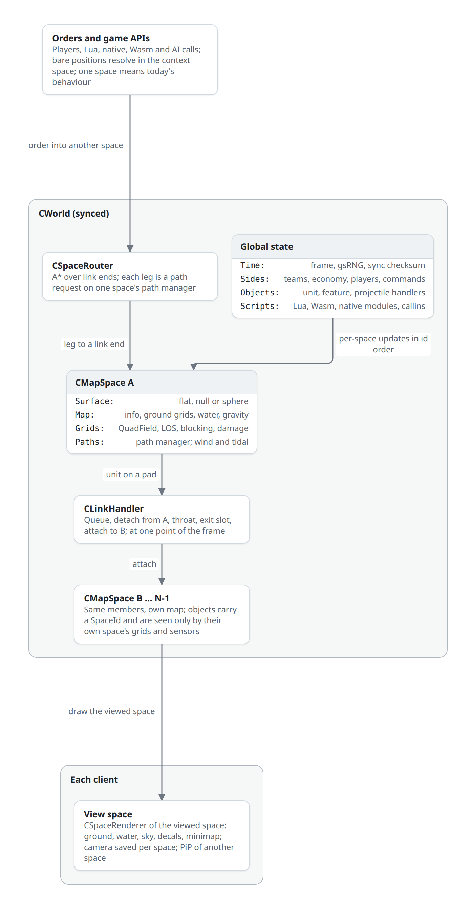

# Multiple map spaces

> Status: proposed, not implemented · 2026-10-11

**A match holds N map spaces in one synchronized simulation.** `CWorld` owns an ordered array of `CMapSpace`. Each space owns its surface (flat heightmap, null plane or sphere), map info, ground grids, quad field, sensors, ground blocking, path manager, map damage, wind and tidal, gravity, water level and, on the unsynced side, its renderer state and minimap. Every world object carries a `SpaceId` and lives in exactly one space; nothing reaches across spaces except through a `CLink`, which moves a unit from one space to another atomically at a fixed point of the sim frame. Teams, economy, commands, time, RNG, Lua states and sync stay global. A standard map is a world with one space, id 0: every object has `spaceId == 0`, the frame does the same work in the same order, and sync checksums are identical to today's.

Built on this page: [wormhole-linked maps](wormhole-maps.md) (standard maps joined by wormholes), [Planetary Annihilation-style planets](planetary-annihilation.md) (a sphere surface). Ship Game's galaxy (`docs/design/galaxy-maps.md` in Ship Game) fits as one null space per star system.



## Model

### World and spaces

```cpp
// rts/Sim/World/World.h (proposed)
using SpaceId = uint8_t;
constexpr SpaceId SPACE_DEFAULT = 0;     // the only space of a standard match
constexpr SpaceId SPACE_NONE    = 0xFF;  // in a link throat; in no space

class CMapSpace {                         // synced part; one per space, fixed after load
public:
	SpaceId id;
	std::string name;                     // unique within the match, from the declaration
	CMapInfo info;                        // the space's mapinfo.lua plus declared overrides
	MapDimensions dims;
	MapSurface surface;                   // FlatSurface | NullSurface | SphereSurface
	std::unique_ptr<CReadMap> readMap;    // CSMFReadMap or CNullReadMap; grids are members, not statics
	SpaceGround ground;                   // today's CGround, bound to this space
	SmoothHeightMesh smoothGround;
	CMetalMap metalMap;
	CGroundBlockingObjectMap blocking;
	BuildingMaskMap buildingMask;
	YardmapStatusEffectsMap yardmapEffects;
	std::unique_ptr<IMapDamage> mapDamage;
	CQuadField quadField;
	CLosHandler los;                      // LOS, air LOS, radar, sonar, seismic, jammers per ally team
	std::unique_ptr<IPathManager> paths;  // QTPFS or HAPFS node layers for this space's terrain
	EnvResourceHandler env;               // wind and tidal
	SpacePhysics physics;                 // gravity, sea level, hardness, water damage, terrain types
};

class CWorld {
public:
	CMapSpace& Space(SpaceId id);
	CMapSpace& Of(const CWorldObject* o) { return Space(o->spaceId); }
	SpaceId NumSpaces() const;
	CLinkHandler links;                   // links, queues, throats, transfers
	CSpaceRouter router;                  // routes over links; legs run on per-space path managers
private:
	std::vector<std::unique_ptr<CMapSpace>> spaces;   // index == SpaceId
};
extern CWorld world;
```

Unsynced state lives beside it in `CSpaceRenderer` (one per space, created on demand; see [Views](#views)).

### Per space or global

| Per space (`CMapSpace`, `CSpaceRenderer`) | Global (`CWorld` and today's handlers) |
|---|---|
| Surface, map dimensions, heightmaps, normals, slope, type and metal maps, smooth mesh | Frame number, game speed, pause |
| Terrain-type table (256 per space, no merging) | `gsRNG`, consumed in the deterministic order of [frame order](#frame-order) |
| Gravity, sea level, hardness, water damage, extractor radius, max metal | Teams, ally teams, players, team resources and storage (`CTeam`) |
| Wind and tidal (`EnvResourceHandler`) | Unit, feature and projectile handlers: ID pools, `MAX_UNITS`, `MAX_FEATURES`, `MAX_PROJECTILES`, update lists |
| Quad field | Unit, weapon, feature and move definitions |
| LOS maps and instances per ally team; radar ghosts; last-seen buildings | Radar error sizes per ally team; global LOS flags |
| Ground blocking, building mask, yardmap status effects | Command queues, command AI, net stream, demo |
| Path manager: node layers per MoveDef, heat maps, flow maps, caches | Lua states (LuaRules, LuaGaia, LuaUI), Wasm and native modules, event handler |
| Map damage, craters, terraform | Sync checker, savegames |
| Map features from that space's map | Intercept handler (filters by space) |
| Ground drawer, ground textures, water, sky, sun and atmosphere, ground decals, grass, map-feature drawing, info textures, minimap image, environment cube map | Model, unit, feature and projectile drawers (draw lists filtered by space), shadow map, screen-space effects, UI |

### Space membership

`CWorldObject` gains `SpaceId spaceId` (`rts/Sim/Objects/WorldObject.h`). It is a plain field, not a `Synced*` primitive, so a one-space match feeds the sync checksum exactly what it feeds today; `CLinkHandler` hashes every transfer explicitly (`CSyncChecker::Sync`) when the world has more than one space.

| Object | Space at creation | Changes by |
|---|---|---|
| Unit | Creator's space (factory, builder, `CreateUnit` in the caller's [context space](#context-space)); start units in the team's `StartSpace` | Link transfer; `Spring.SetUnitSpace`; carried by a transport |
| Transported unit | Transporter's space | Moves with the transporter |
| Feature | Map features: the space whose map lists them; wrecks and heaps: the dying unit's space | Never (Lua may destroy and recreate) |
| Projectile, weapon or Lua-spawned | Owner's or emitting weapon's space; Lua spawns use the context space | Never |
| Explosion (`CExplosionParams`, `rts/Game/GameHelper.h`) | Gains `SpaceId space`, from the projectile or caller | — |
| Ground decals, tracks, scars | The creating object's or explosion's space | — |
| CEG and unsynced particles | The spawning object's space | — |
| Map markers, lights, positional sounds | The space they were made in | — |

Every range, collision and targeting test that takes two objects starts with `a->spaceId == b->spaceId`. Most isolation needs no test at all: queries go through the space's own quad field, LOS maps and blocking map, which contain only that space's objects.

### Surfaces

A space's `MapSurface` answers every geometric question that today assumes a flat `y`-up rectangle. Positions stay `float3` in the space's own Cartesian frame; a space never shares coordinates with another.

```cpp
// rts/Map/Surface/MapSurface.h (proposed)
enum class SurfaceKind : uint8_t { Flat, Null, Sphere };
struct SurfacePoint { uint8_t face; float u, v; };     // flat and null: face 0, u = x, v = z (elmos)
struct LocalFrame   { float3 right, up, forward; };

class MapSurface {
public:
	SurfaceKind Kind() const;

	// frame
	float3 Up(const float3& p) const;                                  // flat: UpVector
	LocalFrame Frame(const float3& p, const float3& forwardHint) const;
	float3 Gravity(const float3& p) const;                             // vector; flat: (0, -g, 0)

	// surface coordinates
	SurfacePoint ToSurface(const float3& p) const;
	float3 FromSurface(const SurfacePoint& s, float height) const;     // height along Up, above the datum

	// ground
	float  GroundHeight(const SurfacePoint& s, bool synced) const;     // today's GetHeightReal
	float  GroundHeightApprox(const SurfacePoint& s, bool synced) const;
	float3 GroundNormal(const SurfacePoint& s, bool synced) const;
	float  Slope(const SurfacePoint& s, bool synced) const;
	float  Elevation(const float3& p, bool synced) const;              // p's height above ground along Up
	float  SeaLevel() const;                                           // per space; today constant 0

	// rays
	float RayGround(const float3& from, const float3& dir, float len, bool synced) const;
	float RayGroundWater(const float3& from, const float3& dir, float len, bool testWater, bool synced) const;
	float TrajectoryGround(const float3& start, const float3& dir, float len, float lin, float qdr) const;

	// bounds, distance, grids
	bool   InBounds(const float3& p) const;                            // sphere: always true
	float3 ClampInBounds(const float3& p) const;
	float  GroundDistance(const float3& a, const float3& b) const;     // flat: xz distance; sphere: arc
	const SurfaceGrid& Grid(GridLevel level) const;                    // square, half-square, LOS mip, quad
};

class SurfaceGrid {   // cell addressing shared by every per-space grid
public:
	uint32_t CellCount() const;
	CellId CellOf(const SurfacePoint& s) const;                        // flat: z * width + x
	SurfacePoint CellCentre(CellId c) const;
	int Neighbours(CellId c, std::array<CellId, 8>& out) const;        // crosses cube faces on a sphere
	template<class F> void ForEachInDisc(const SurfacePoint& c, float radius, F&& f) const;
	template<class F> void ForEachOnSegment(const SurfacePoint& a, const SurfacePoint& b, F&& f) const;
};
```

| Surface | Ground data | Use | Status |
|---|---|---|---|
| `FlatSurface` | SMF heightmap grids (`CSMFReadMap`) | Every BAR and Zero-K map | Today's `CGround` and `CReadMap` code, moved behind the space |
| `NullSurface` | None: a plane at height 0, sparse quad field, zero-page grids | Ship Game; space between planets | Today's `CNullReadMap` and its `IsNullMap()` branches (commit `67a252a0bf`) |
| `SphereSurface` | Cube-sphere height grids, radial up and gravity | [PA-style planets](planetary-annihilation.md) | Designed there; this interface is its contract |

Dispatch rules:

- `CMapSpace::surface` is a `std::variant<FlatSurface, NullSurface, SphereSurface>`. Point queries (`GroundHeight`, `GroundNormal`, `Elevation`) branch on `Kind()` inside `SpaceGround`, as the null map's `IsNullMap()` branch does today; no virtual call per query.
- Subsystems that walk grids (LOS raycasts and circles, quad-field rectangles, blocking footprints, QTPFS node layers) are templates on the surface type. The `FlatSurface` instantiation is today's code; `CellOf` is the same row-major index.
- Flat-only assumptions stay valid inside `FlatSurface` and `NullSurface`: `y` is up, headings come from `GetHeadingFromVector(dx, dz)`, ballistics are parabolas. A sphere replaces them through `Frame`, `Gravity` and `GroundDistance`; the call sites it touches (201 `UpVector`, 54 `GetHeadingFromVector`, ballistic solvers) are counted in the PA article.

### Frame order

`CGame::SimFrame` (`rts/Game/Game.cpp`) keeps its order. Global handlers run once; per-space updates run in ascending `SpaceId`. With one space this is today's sequence.

```text
helper->Update()
for space in world (ascending id):  space.readMap->Update(); space.smoothGround.Update(); space.mapDamage->Update()
unitHandler.Update()                 // one list, activation order; each unit queries world.Of(unit)
for space in world:                  space.paths->Update()
projectileHandler.Update()           // one list; collisions through the projectile's space
featureHandler.Update()
unitScriptEngine->Tick(); unitHandler.UpdatePostAnimation()
nativeInterfaceSystem->Tick()
world.links.Update()                 // NEW: admit, detach, exit, attach; link id order, then queue order
for space in world:                  space.env.Update()      // wind draws gsRNG in space order
for space in world:                  space.los.Update(); ghosts of space
interceptHandler.Update()
teamHandler.GameFrame(); playerHandler.GameFrame(); eventHandler.GameFramePost()
```

Transfers run after units, projectiles and scripts finished the frame and before LOS, so a unit is never half in two spaces and sensors see it in its new space on the frame it arrives. Per-space LOS and path updates write only their own space and may later run in parallel with a fixed merge order; `env.Update` stays sequential because it draws `gsRNG`.

## Per-space subsystems

Counts are `grep` matches over `rts/` at `45c811a942`, excluding `rts/lib`.

| Subsystem | Today | Per space | Call sites |
|---|---|---|---|
| Map reader | `readMap` global; grids are `static` members of `CReadMap` (`rts/Map/ReadMap.h`) | `space.readMap`; statics become members so two maps can be loaded | `readMap->` 333 in 77 files; `mapDims.` 736 in 93 |
| Ground queries | `CGround`: static functions over `readMap` (`rts/Map/Ground.h`) | `SpaceGround` bound to one space; same function names | `CGround::` 306 in 81 |
| Water | `CGround::GetWaterPlaneLevel` is `consteval` 0 | `surface.SeaLevel()` per space; default 0 | `GetWaterPlaneLevel\|GetWaterLevel` 72 in 20 |
| Gravity | `mapInfo->map.gravity` | `space.physics.gravity`, vector through `surface.Gravity(p)` | 29 in 17 |
| Map info | `mapInfo` global (`rts/Map/MapInfo.h`) | `space.info` | `mapInfo->` 191 in 53 |
| Quad field | `quadField` (`rts/Sim/Misc/QuadField.h`) | `space.quadField`; null spaces keep the sparse quads | `quadField.` 141 in 43 |
| Sensors | `losHandler` (`rts/Sim/Misc/LosHandler.h`), maps sized `mapDims >> losMipLevel` | `space.los`, maps sized from the space | `losHandler->` 119 in 38 |
| Ground blocking, building mask, yardmap effects | `groundBlockingObjectMap`, `buildingMaskMap` | Per space | 32 in 16 (blocking) |
| Smooth mesh (aircraft) | `smoothGround` | Per space | 84 in 10 |
| Metal | `metalMap` (`rts/Map/MetalMap.h`) | Per space | 37 in 11 |
| Map damage | `mapDamage` | Per space; craters only in the explosion's space | 48 in 13 |
| Wind, tidal | `envResHandler` (`rts/Sim/Misc/Wind.h`) | Per space | 46 in 18 |
| Pathing | `pathManager` created once in `CGame` from `modInfo.pathFinderSystem` (`rts/Sim/Path/IPathManager.cpp`); QTPFS and HAPFS keep process-wide ECS registries (`QTPFS::registry`: 177 uses in 10 files) | One `IPathManager` per space; one shared registry whose path entities carry a `PathSpace` component; path IDs stay global; QTPFS worker threads shared | `pathManager->` 68 in 15 |
| Bounds | `float3::ClampInBounds`, `IsInBounds`, `ClampInMap`, `IsInMap` against `mapDims` | `surface.InBounds`, `surface.ClampInBounds` | 94 in 36 |
| Features | `featureHandler`, one map's features at load | Global handler; each space loads its map's features with its `spaceId` | `featureHandler.` 131 in 32 |
| Projectiles | `projectileHandler` | Global list; quad field and ground tests through the projectile's space | `projectileHandler.` 67 in 34 |
| Ground decals | `groundDecals` (`rts/Rendering/Env/IGroundDecalDrawer.h`) | `CSpaceRenderer::decals` | 124 in 17 |
| Ground drawer | `readMap->GetGroundDrawer()` | Per space, inside its read map | — |
| Water renderer | `IWater::GetWater()`, `waterRenderingInst` | Per space | 16 in 12 |
| Sky, sun, atmosphere | `ISky::GetSky()`, `sunLightingInst`, `mapRenderingInst` | Per space | `ISky::GetSky()` 51 in 22 |
| Grass, tree and map-feature drawing | `grassDrawer`; feature drawer | Grass per space; feature draw list filtered by space | — |
| Info textures | `infoTextureHandler` | Per space, created when first bound (as the null map does) | 40 in 16 |
| Minimap | `minimap` (`rts/Game/UI/MiniMap.cpp`) | Draws the view space; one minimap image per space | `minimap->` 119 in 25 |
| Camera | `camHandler`, controllers clamp to `mapDims` | Saved state per space; clamps to the view space's surface | `camHandler->` 102 in 16 |
| Shadows | `shadowHandler` | Global; renders the view space | 105 in 25 |
| Map marks | `inMapDrawerModel`, `NETMSG_MAPDRAW` with `x, z` only | Marks carry a space | — |

## Links

### Link data

```cpp
// rts/Sim/World/Link.h (proposed)
using LinkId = uint16_t;
enum class LinkDir : uint8_t { AtoB, BtoA };
enum class LinkState : uint8_t { Open, Closed };

struct LinkEnd {
	SpaceId space;
	float3 pos;              // pad centre in the space's frame
	float heading;           // exit heading; entry faces the opposite way
	float padRadius;         // units on the pad may be admitted
	float spreadRadius;      // arrivals are placed inside it; building-masked
	int endUnitID = -1;      // optional Gaia unit for looks and tooltip; does not carry the rules
};

struct LinkRules {
	std::bitset<MoveDefHandler::MAX_MOVE_DEFS> moveDefs;  // ground MoveDefs allowed
	bool air = false;                     // aircraft may pass
	int2 maxFootprint;                    // xsize, zsize in squares
	CargoRule cargo = CargoRule::EachMustPass;
	float capacityArea;                   // footprint squares admitted per window, per direction
	int windowFrames, transitFrames, cooldownFrames;
	bool oneWay = false;
	ExitRule exit = ExitRule::HoldUntilFree;
	VisionRule vision = VisionRule::Flares; // Flares | Window(radius)
	bool passProjectiles = false;           // reserved; see what crosses
};

struct CLink {
	LinkId id;
	LinkEnd a, b;
	LinkRules rules;
	LinkState state = LinkState::Open;
	std::array<std::deque<int>, 2> queue;                 // unit IDs per direction, FIFO
	std::array<float, 2> budget;                          // footprint area left in the window
	std::vector<ThroatEntry> throat;                      // {unitID, dir, exitFrame}, ordered by exitFrame then unitID
};
```

Links are declared with the spaces ([declaring spaces](#declaring-spaces)) or created by synced Lua or Wasm at any time (`Spring.CreateLink`). Creating a link building-masks both spread areas in their spaces and adds the link to the [space graph](#space-graph).

### Transfer

`CLinkHandler::Update` runs once per frame ([frame order](#frame-order)): links in id order, directions A→B then B→A, queues front to back.

| Step | What happens | Engine parts |
|---|---|---|
| Queue | A unit whose route leg ends at a link and that stands on the pad joins the direction's queue; queued units hold position around the pad | Move type, `CLinkHandler` |
| Admit | Head of queue passes if the link is open, its MoveDef or air flag and footprint fit, every cargo unit fits (`EachMustPass`), its cooldown expired, the window budget covers its footprint, and `AllowUnitTransit` returns true | `LinkRules`, synced callin |
| Detach from A | Remove from A's quad field, unblock A's squares, remove A's LOS, radar and jammer instances, delete A's path, clear weapon targets, notify units targeting, guarding or following it (`TargetLeftSpace`), set void state (`CSolidObject::SetVoidState`), `spaceId = SPACE_NONE`; cargo detaches with it; `UnitLeftSpace` | `CWorld::Detach` |
| Throat | Kept alive, selectable and with its orders; not simulated, drawn, sensed, targetable or collidable; `transitFrames` may be 0 | `CLink::throat` |
| Exit | At `exitFrame`, pick the nearest free position to the far pad inside `spreadRadius` for the unit's footprint (ring search over B's blocking map); with none free, `HoldUntilFree` keeps it in the throat and blocks the queue behind it | `CWorld::FindExitSlot` |
| Attach to B | Map position, velocity and orientation ([frame mapping](#frame-mapping)); `spaceId = B`; add to B's quad field, block, LOS instances; snap draw interpolation (`preFrameTra = pos`); clear void state; start the next route leg; cargo attaches; `UnitEnteredSpace` | `CWorld::Attach` |
| Cooldown | `unit->linkCooldownUntil` stamped for this link | `CUnit` |

Detach and attach of one unit happen within one `CLinkHandler::Update` call when `transitFrames == 0`; with a throat, the unit is in no space in between. No other sim code runs between the detach and the attach of a step, so no query ever finds a unit in two spaces or a half-moved one. `Spring.SetUnitSpace(unitID, spaceID, x, y, z, heading)` performs the same detach and attach without a link, for game rules (respawns, scripted transport).

### Frame mapping

Each link end has a frame: its pad position, `surface.Frame(pos, heading)`. On transfer from end E to end X:

| Quantity | Mapping |
|---|---|
| Position | Exit slot from the ring search; ground units on the ground, aircraft at `Elevation` clamped between X's ground plus their minimum altitude and their cruise altitude |
| Velocity | `v_local = Frame(E)ᵀ · v`, turned 180° about up (entering E means leaving X), `v' = Frame(X) · v_local`; ground units keep speed along the exit heading |
| Orientation | `frontdir`, `rightdir`, `updir` mapped the same way, then `updir` realigned to `surface.Up(pos')` |
| Commands | Unchanged queue; the current command's path is reset and the [route](#route-search) continues with its next leg |
| Experience, health, states, build progress, cargo, selection, groups | Unchanged |

### What crosses a link

| Thing | Crosses | Reason |
|---|---|---|
| Mobile units within the link's rules | Yes, through the queue and throat | The purpose of a link |
| Structures, nanoframes, features | No | Not mobile; Lua may recreate them |
| Projectiles, beams, explosions, craters, decals | No; a projectile is never moved between spaces | `passProjectiles` is reserved for a later rule that spawns a fresh projectile at the far end |
| LOS, radar, sonar, seismic, jammers | No | Per-space maps; `VisionRule::Window` adds a small LOS instance at the far end for the ally team of a unit on the near pad |
| Weapon targets, guard, follow, build, repair, reclaim, capture, load | No direct reach; orders follow by [routing](#orders) | Range tests require the same space |
| Sound | No | Positional sounds play only in the view space |
| Team resources | Yes, always | The economy is global |

## Routing across spaces

Paths inside a space stay the job of that space's path manager. A route over spaces is a sequence of legs, each an ordinary path request in one space.

### Space graph

| Element | Content | Source |
|---|---|---|
| Nodes | Every link end (two per link) | `CLinkHandler` |
| Link edges | End E to its paired end X for each open direction; cost `transitFrames` plus expected queue wait (`queued footprint area / capacityArea × windowFrames`) | Link rules and live queues |
| Space edges | End E to end F in the same space, per MoveDef; cost = path length / MoveDef max speed, or unreachable | `EndCostTable[space][moveDef][e][f]`, filled at load by that space's path manager |
| Air edges | Same, per aircraft class: straight-line distance / speed | Surface `GroundDistance` |
| Space distance bound | `SpaceHops[s][t]`: minimum link cost from any end in `s` to any end in `t` | All-pairs over the spaces, after `EndCostTable` |

`EndCostTable` holds k² entries per MoveDef per space with k link ends in the space, a few hundred paths for a typical match, computed on the loading screen with the QTPFS worker threads. An entry is recomputed lazily when a `TerrainChange` or blocking change intersects the bounding rectangle stored with it, or when a link is created or destroyed.

### Route search

`CSpaceRouter::Route(moveDef, from = (sA, p), to = (sB, q)) -> SpaceRoute`:

1. If `sA == sB` and `q` is reachable in `sA` for this MoveDef, return no legs: an ordinary path. Reachability uses the path manager's component information for the start and goal squares.
2. Otherwise add a start node joined to each end in `sA` and a goal node joined from each end in `sB`. Their edge costs are straight-line lower bounds (`GroundDistance / maxSpeed`); ends a MoveDef cannot leave or reach are already marked in `EndCostTable`.
3. A* over the graph with heuristic `SpaceHops[space of node][sB]`, admissible because every edge cost is at least its link and space-edge share.
4. Result: `SpaceRoute { std::vector<RouteLeg> legs; }` with `RouteLeg { SpaceId space; float3 goal; LinkId link; LinkDir dir; }`. The move type keeps it (`AMoveType::route`) and requests a path for the current leg only.

| Situation | Behaviour |
|---|---|
| Leg goal reached | The unit queues at the link; after exit, the next leg's path is requested in the new space |
| Queue at the next link grows | When the unit reaches a pad whose expected wait exceeds the next-best route by a margin, it re-routes once per leg (hysteresis) |
| Link closed or destroyed | Routes through it are dropped from the cache; units on legs towards it re-route; units in its throat exit as normal |
| No route | The order fails as an unreachable move does today |
| Groups | Units with the same MoveDef, start space and goal share the graph part through `RouteCache` keyed by (MoveDef, start space, goal space, goal cell); each requests its own legs |
| First and last legs | Costs in the search are lower bounds; the leg path itself is exact. A start behind a cliff may pick a slightly worse link; accepted |

Lua, Wasm and AIs get the router as `Spring.RequestRoute` (and equivalents); `Spring.RequestPath` stays a one-space request in the context space.

### Orders

`Command` (`rts/Sim/Units/CommandAI/Command.h`) gains `SpaceId space`, the space of its position parameters. It defaults to the unit's space when the command is inserted, so existing senders keep today's meaning.

| Order | Across spaces |
|---|---|
| Move, fight, patrol | Routed; patrol between spaces loops through links |
| Attack unit, guard, follow, load, unload onto a target | Routed to the target's space; re-routed when the target transits (`TargetLeftSpace`) |
| Build, repair, reclaim, resurrect, capture | Routed; the order runs when the builder is in range in the target's space |
| Attack ground, area attack, area reclaim, area capture | Valid only in one space; an area never spans spaces |
| Factory rally and queue | Routed from the factory's space |
| Transit (`CMD_TRANSIT`, params: link ID) | Explicit: go through this link; for scripted control and AIs |

## Views

| Element | Behaviour | Names |
|---|---|---|
| View space | Each local player looks at one space at a time | `gu->viewSpace`; `Spring.GetViewSpace()`, `Spring.SetViewSpace(spaceID)`; action `/viewspace <name\|next\|prev>`; callin `ViewSpaceChanged(newSpace, oldSpace)` |
| Camera | State saved per space and restored on switch; controllers clamp to the view space's `surface` | `CCameraHandler::spaceCamStates` |
| World draw | `CWorldDrawer::Draw` binds the view space's `CSpaceRenderer`; model, feature and projectile draw lists skip `spaceId != viewSpace` in `UpdateObjectDrawFlags` (`rts/Rendering/Units/UnitDrawerData.cpp`) | `CSpaceRenderer` |
| Picture-in-picture | Another space drawn into a texture with a reduced pass: no shadow map, no reflections, coarser ground detail; one per frame, at a configurable size and refresh interval | `CSpaceRenderer::DrawToTexture(camera, fbo, quality)`; Lua `gl.RenderSpace(spaceID, camState, texture)` |
| Minimap | Shows the view space; clicks resolve in it | Lua textures `$minimap` (view space) and `$minimap:<spaceID>` |
| Overview | Drawn by the game from engine data: spaces, links, queues, per-space units within the alliance's knowledge, `$minimap:<spaceID>` images | `Spring.GetSpaces`, `Spring.GetLinks`, `Spring.GetSpaceUnits(spaceID)` (unsynced, LOS-filtered) |
| Input | Mouse rays (`TraceRay::GuiTraceRay`, `rts/Game/TraceRay.h`) in the view space; commands from the main view, a PiP or a minimap carry that view's space | `CGuiHandler` |
| Selection, groups | May span spaces; the engine keeps one selection | `Spring.GetUnitSpace` lets the UI group by space |
| Sound | Listener in the view space; positional sounds of other spaces are not played | `CSound` |
| Markers | Carry a space; markers elsewhere reach the overview | `NETMSG_SPACE_MAPDRAW` |
| Spectators | Same switching; full view shows every space's units | — |
| Renderer residency | View and PiP spaces fully resident; others keep only minimap and heightmap textures; full resources load on first view and stay until `SpaceRenderBudgetMB` is exceeded, least recently viewed first | `CSpaceRenderer::Residency` |

## Game APIs

### Context space

Every API that takes a bare position resolves it in a context space. Object-keyed calls use the object's space and ignore the context.

| Caller | Context at entry |
|---|---|
| Synced callin about one object (`UnitCreated`, `UnitDamaged`, `AllowCommand`, `FeatureCreated`, `ProjectileCreated`, `Explosion` …) | That object's space |
| Other synced callins (`GameFrame`, `Initialize`, `RecvLuaMsg` …) | `SPACE_DEFAULT` |
| Unsynced callins (widgets, unsynced gadgets, draw callins) | The view space; draw callins inside `gl.RenderSpace` see that space |
| Skirmish AI | `SPACE_DEFAULT` until `Space_setContext` |
| `Spring.SetContextSpace(spaceID)` | Until the callin returns; the engine restores the context after every callin |

In a one-space match the context is always 0, so every existing call means what it means today.

### Lua

| Addition | Signature |
|---|---|
| Space table | `Game.spaces[i] = {id, name, mapName, surface = "flat"\|"null"\|"sphere", sizeX, sizeZ, gravity, seaLevel, vfsRoot}`; `Game.mapSizeX`, `Game.mapX` and friends describe space 0 |
| Space info | `Spring.GetSpaces()`, `Spring.GetSpaceInfo(spaceID)` |
| Context | `Spring.GetContextSpace()`, `Spring.SetContextSpace(spaceID)` |
| Membership | `Spring.GetUnitSpace(unitID)`, `Spring.GetFeatureSpace(featureID)`, `Spring.GetProjectileSpace(projectileID)` |
| Transfer (synced) | `Spring.SetUnitSpace(unitID, spaceID, x, y, z [, heading])` |
| Links (synced) | `Spring.CreateLink(def) -> linkID`, `Spring.DestroyLink(linkID)`, `Spring.SetLinkState(linkID, "open"\|"closed")`, `Spring.SetLinkRules(linkID, rules)` |
| Links (read) | `Spring.GetLinks()`, `Spring.GetLinkInfo(linkID)`, `Spring.GetLinkQueue(linkID, dir)` |
| Routing | `Spring.RequestRoute(unitID or moveDefName, fromSpace, fx, fy, fz, toSpace, tx, ty, tz) -> legs` |
| Commands | Command tables gain `space`; `Spring.GiveOrderToUnit` uses the context space for position parameters |
| Views (unsynced) | `Spring.GetViewSpace()`, `Spring.SetViewSpace(spaceID)`, `Spring.GetSpaceUnits(spaceID)`, `gl.RenderSpace(spaceID, camState, texture)`, textures `$minimap:<spaceID>`, `$heightmap:<spaceID>` |

Existing functions keep their signatures (registrations today: `LuaSyncedRead` 253, `LuaSyncedCtrl` 192, `LuaUnsyncedRead` 175, `LuaUnsyncedCtrl` 170).

### Native and Wasm

| Part | Change |
|---|---|
| New `spaces` interface | Space list and info, context get and set, object space queries, links, routes, view space |
| Position-taking functions | A new version of each affected interface adds `space: SpaceId` to the query record, with `SPACE_CONTEXT` meaning the context space; the previous interface version stays served with context semantics. About 190 of the 1414 functions in `rts/wasm/generated/model.json` (native API 1.14.0) carry position fields, Gfx screen coordinates included |
| Callins | `UnitEnteredSpace`, `UnitLeftSpace`, `LinkStateChanged`, `AllowUnitTransit`, `ViewSpaceChanged` in `rts/NativeInterface/api/Callins.def` |
| Codegen | Records and versions come from the generator (`rts/wasm/docs/recoil_wasm_api_codegen.md`, "Versioning"); its open versioning rules decide how old modules are served |

### Skirmish AI

| Part | Change |
|---|---|
| Callbacks (`rts/ExternalAI/SSkirmishAICallbackImpl.h`) | `Space_getCount`, `Space_getName`, `Space_getMapName`, `Space_getContext`, `Space_setContext`; `Unit_getSpace`, `Feature_getSpace`; `Link_getCount`, `Link_getEnd`, `Link_getRules`, `Link_getQueueLength`; `Route_request` |
| Existing 46 `Map_*` callbacks | Answer for the AI's context space |
| Commands | Position commands use the context space |
| Events | `EVENT_UNIT_ENTERED_SPACE`, `EVENT_UNIT_LEFT_SPACE`, `EVENT_LINK_STATE_CHANGED` |
| Legacy AIs | Unchanged in one-space matches; in multi-space matches see [open decisions](#open-decisions) |

### Callins

| Callin | Synced | Arguments |
|---|---|---|
| `UnitLeftSpace` | Both | `unitID, unitDefID, teamID, spaceID, linkID` (−1 for `SetUnitSpace`) |
| `UnitEnteredSpace` | Both | `unitID, unitDefID, teamID, spaceID, fromSpaceID, linkID` |
| `UnitTransitQueued` | Both | `unitID, linkID, dir` |
| `AllowUnitTransit` | Synced | `unitID, linkID, fromSpaceID, toSpaceID` → bool |
| `LinkStateChanged` | Both | `linkID, state` |
| `ViewSpaceChanged` | Unsynced | `newSpaceID, oldSpaceID` |

Unsynced callins about units in another ally team's view follow today's LOS rules per space. Defined in `rts/System/Events.def`.

### Network, replays and savegames

| Item | One space | Several spaces |
|---|---|---|
| `NETMSG_COMMAND`, `NETMSG_AICOMMAND` (`rts/Net/Protocol/NetMessageTypes.h`) | Unchanged bytes | Commands in the unit's own space unchanged; others as `NETMSG_SPACE_COMMAND` (`playerNum, space, id, options, params`) |
| `NETMSG_MAPDRAW` | Unchanged | `NETMSG_SPACE_MAPDRAW` for space ≠ 0 |
| `GameData` map checksum (`rts/Game/GameData.h`) | One | Checksum list, one per space archive |
| Demo | Unchanged format; old demos replay | Start script carries the space declaration |
| Sync checksum | Unchanged | Plus each transfer |
| Savegames | Unchanged | `CWorld` and every space serialized through creg; Lua savegames store each space's heightmap |

## Declaring spaces

### Map archive

A map archive's `mapinfo.lua` may list spaces and links. Without a `spaces` table the archive is one space, as today.

```lua
-- mapinfo.lua (proposed fields)
spaces = {
  { name = "home" },                                      -- this archive's own SMF: space 0
  { name = "north", map = "Comet Catcher Redux v3.1",     -- another map archive, listed in depend
    options   = { },                                      -- that map's map options
    overrides = { gravity = 100, tidal = 15, wind = { min = 5, max = 20 },
                  water = { level = -40 }, atmosphere = { }, lighting = { } } },
  { name = "rift",  smf = "maps/rift.smf" },              -- a second SMF inside this archive
  { name = "void",  null = { sizeX = 64, sizeZ = 64 } },  -- a null space
},
links = {
  { name = "w1",
    a = { space = "home",  x = 1200, z = 3400, heading = 0 },
    b = { space = "north", x = 800,  z = 900,  heading = 32768 },
    rules = "medium" },
},
linkRules = { medium = { moveDefs = { "TANK3", "BOT3", "HOVER3" }, maxFootprint = { 4, 4 }, transitSeconds = 3 } },
startSpaces = { "home", "north" },                        -- per start position
```

### Start script

```text
[GAME] {
  MapName=Twin Rivers Link v1;          // space archive, or an ordinary map (one space)
  [SPACE1] { Name=north; MapName=Comet Catcher Redux v3.1; [MAPOPTIONS] { } }   // add or replace by index
  [LINK0]  { A=home; AX=1200; AZ=3400; AHeading=0; B=north; BX=800; BZ=900; BHeading=32768; Rules=medium; }
  [TEAM0]     { StartSpace=north; StartPosX=…; StartPosZ=…; }
  [ALLYTEAM0] { StartSpace=north; StartRectLeft=…; … }
}
```

`CGameSetup` (`rts/Game/GameSetup.cpp`) merges the archive's declaration and the script's sections (script wins, by index) into `WorldSetup { std::vector<SpaceSetup>; std::vector<LinkSetup>; }`. A lobby can therefore compose a match from ordinary maps without a new archive; the demo keeps the script, so replays rebuild the same world. `CBlankMapGenerator` (`rts/Map/Generation/BlankMapGenerator.cpp`) generates blank or null spaces from per-space options as it does for one map.

### Files and checksums

| Item | Rule |
|---|---|
| Archives | Every space's archive is resolved by the archive scanner (`depend` for archive-declared spaces), checksummed and listed in `GameData`; a missing one fails like a missing map |
| VFS | Space 0 is mounted at the root, as today (`CPreGame`, `rts/Game/PreGame.cpp`). Space k's archive is mounted read-only at `spaces/<name>/` (`Game.spaces[k].vfsRoot`); its `mapinfo.lua`, SMF and SMT are read from there (`MapParser`, `rts/Map/MapParser.cpp`, reads `mapinfo.lua` at the root today) |
| Map-shipped Lua | Map gadgets and widgets run from space 0's archive only; games read other spaces' map configs by prefix |
| Path caches | Keyed per space by that map's checksums, so a member map reuses its own cache files |
| Lobby | unitsync (`tools/unitsync/unitsync.cpp`) gains `GetMapSpaceCount(mapIndex)` and `GetMapSpaceInfo(mapIndex, i)`; a lobby that ignores them shows space 0's map, minimap and start boxes |

### Tools

| Tool | Behaviour |
|---|---|
| Map making | Each space is an ordinary map, made and tested with today's tools |
| Link placement | A dev widget: switch spaces, place and orient ends, set rules, write the `links` table |
| Validator | `spring --validate-map <archive>` boots headless: every space loads; each link end is passable for every allowed MoveDef and reaches the space's start positions; spread areas are free of features; feature totals fit `MAX_FEATURES` with headroom; terrain types need no merging |

## Engine today

| Fact | Source | Consequence |
|---|---|---|
| One map per match: `CReadMap::LoadMap` creates one `CSMFReadMap` or `CNullReadMap`; `readMap`, `mapDims` are globals; height, normal, slope and type grids are `static` members | `rts/Map/ReadMap.h`, `rts/Map/ReadMap.cpp` | Two maps cannot be loaded until the statics become members |
| A null map already exists as a second ground implementation behind `IsNullMap()` branches (23 sites) | `rts/Map/Null/NullReadMap.h`, commit `67a252a0bf` | The surface split has a working precedent and a test bed |
| Sim singletons: `quadField`, `losHandler`, `pathManager`, `groundBlockingObjectMap`, `buildingMaskMap`, `smoothGround`, `metalMap`, `mapDamage`, `envResHandler`, `mapInfo` | `extern` declarations in their headers | Each becomes a space member |
| Path entities live in process-wide ECS registries | `rts/Sim/Path/QTPFS/Registry.h`, `rts/Sim/Path/HAPFS/Registry.h` | One registry with a space component is cheaper than a registry per space |
| Unit void state hides a unit from collisions, projectiles and quad-map rays | `CSolidObject::SetVoidState` in `rts/Sim/Objects/SolidObject.cpp` | The link throat reuses it |
| Draw lists are built per object against the camera | `CUnitDrawerData::UpdateObjectDrawFlags` | A space filter is one compare per object |
| Sync checksums hash assignments of `Synced*` primitives | `rts/System/Sync/SyncedPrimitive.h`, `SyncChecker.h` | A plain `spaceId` field leaves one-space checksums unchanged |
| Commands carry an ID, options and float parameters, no space | `Command.h`, `NETMSG_COMMAND` | Space goes in a new field and a new message used only across spaces |
| Map archive mounted at the VFS root; `mapinfo.lua` read from the root | `PreGame.cpp` (`AddArchiveWithDeps`), `MapParser.cpp` | Further spaces need prefixed mounts |
| `MAX_UNITS + MAX_FEATURES` must fit 16 bits for the network protocol | `rts/Sim/Misc/GlobalConstants.h` | Caps stay global across spaces |
| Lockstep: every client simulates every object | Recoil's synced simulation | Sim cost is the sum over spaces; only rendering follows the view |

## Migration

The space abstraction enters with exactly one space, call sites move behind it subsystem by subsystem with one-space behaviour proven identical, and only then does a second space load.

### Call sites

From the [per-space subsystem table](#per-space-subsystems). Map and sim globals (`CGround::`, `readMap->`, `mapDims.`, `quadField.`, `losHandler->`, `pathManager->`, blocking, smooth mesh, metal, map damage, wind) by directory:

| Directory | Matches |
|---|---:|
| `rts/Sim` | 484 |
| `rts/Rendering` | 314 |
| `rts/Map` | 291 |
| `rts/Game` | 254 |
| `rts/NativeInterface` | 242 |
| `rts/Lua` | 236 |
| `rts/ExternalAI` | 45 |
| `rts/System` | 41 |

Unsynced view globals add `camera->` 527 in 85 files, `minimap->` 119, `camHandler->` 102, `shadowHandler.` 105, `groundDecals->` 124; most keep working against the view space unchanged.

| Technique | Where | Effect |
|---|---|---|
| Object-keyed dispatch | `losHandler->InLos(unit, allyTeam)`, `quadField.MovedUnit(unit)`, `pathManager->DeletePath(pathID)` | Signatures stay; the facade picks `world.Of(obj)`. Removes most sim call-site edits |
| Explicit space for position-keyed calls | `CGround::GetHeightReal(x, z)`, `quadField.GetUnitsExact(pos, r)`, `losHandler->InLos(pos, allyTeam)` | Become `space.ground.GetHeightReal(x, z)` with `space` from the object being processed; no ambient space in C++ |
| Globals as references first | Step 1 | `readMap`, `quadField` … become references into space 0, so nothing else changes in that commit |
| Delete the global per subsystem | End of each subsystem's change | The compiler lists every call site left; nothing is missed silently |
| Context space in scripting | `rts/Lua`, `rts/NativeInterface`, `rts/ExternalAI` | Position calls read the context; one helper per API layer |

### Proving identity

| Check | Tool | Pass |
|---|---|---|
| Sync | Per-frame sync log and demo replay runner (items 2 and 5 of `rts/wasm/docs/recoil_wasm_sync_verification.md`, built first); demos recorded on the base commit, replayed on base and on each refactor commit (the demo engine-version check must accept the test build) | Identical sync logs on every frame; no `[DESYNC WARNING]` |
| Coverage | BAR synctest (`test/synctest`), Wasm Core parity (`test/native_api_parity`), BAR and Zero-K demos with nukes, terraform, transports and air; Ship Game's replay library on a null map | All identical |
| Performance | Same demos headless, Tracy zones and wall time | Frame time, boot time and resident memory within the spread of repeated base runs |
| Behaviour outside sync | Captures of the same demo frames at RTS height and close zoom | Pixel-identical, or differences explained by draw-order-independent effects |

## Performance and memory

### Memory

Per square of an SMF space, calculated from the array types, not measured (a map unit is 64 × 64 squares):

| Data | Bytes per square | Source |
|---|---:|---|
| Corner heightmaps: synced, unsynced, original, as loaded | 16 | `CReadMap::Initialize`, `CSMFReadMap::LoadHeightMap` |
| Face normals, synced and unsynced (two per square) | 48 | `faceNormalsSynced/Unsynced` |
| Centre normals synced, unsynced, 2D | 36 | `centerNormals*` |
| Centre and max heightmaps, centre mips | ≈ 9.3 | `centerHeightMap`, `maxHeightMap`, `mipCenterHeightMaps` |
| Slope, type, metal and extraction maps (half resolution) | ≈ 2.5 | `slopeMap`, `typeMap`, `MetalMap` |
| Ground-blocking cell | 72 | `ArrayCell<CSolidObject>` in `GroundBlockingObjectMap.h` |
| QTPFS speed-bin cache | 1 per MoveDef | `NodeLayer::MapSquareData` |
| GPU: heightmap R32F, normals RG16F, shading RGBA8 | 12 | `SMFReadMap.cpp` texture creation |

About 180 B per square in RAM before path layers: a 16 × 16 space (about 1.05 million squares) is roughly 190 MB, and spaces add up. A null space costs almost nothing per area. Diffuse ground tiles, splats and other map textures are per space and are what [renderer residency](#views) evicts.

### Per-frame cost

| Cost | Scales with | Empty space |
|---|---|---|
| Units, features, projectiles | Objects in all spaces (lockstep) | — |
| Height bounds, smooth mesh, map damage | Changed rectangles in the space | ≈ 0 |
| LOS update | Moved sensors in the space | ≈ 0 |
| Path manager | Requests and terrain changes in the space | ≈ 0 |
| Wind, tidal | Spaces | Constant, small |
| Links | Queued and transiting units | — |
| Router | Cross-space orders; graph of 2 × links nodes; cached | — |
| Rendering | View space, plus a PiP | Not drawn |

A space with no objects costs memory, not frame time. Nothing lets a client skip a space: every client simulates every space.

## Effort and risk

Estimates for one engineer who knows Recoil, ±50 %, not measured.

| Area | Work | Weeks | Risk |
|---|---|---:|---|
| World skeleton | `CWorld`, `CMapSpace`, `SpaceId`, `CReadMap` statics to members, globals as references | 2–3 | Low |
| Ground and map reader | `CGround`, `readMap`, `mapDims`, map info, water, gravity, bounds | 4–6 | Medium: hottest queries; frame time |
| Grids | Quad field, blocking, building mask, yardmap effects, smooth mesh, metal, map damage | 3–4 | Medium |
| Sensors | LOS handler per space | 2–3 | Medium: sync |
| Pathing | QTPFS and HAPFS per space, shared registry and threads, caches | 3–5 | High: threading and caches |
| Objects | Space on objects, features per space, projectiles, explosions, decals | 3–4 | Medium |
| Loading | N archives, VFS prefixes, per-space map info, checksums, `WorldSetup` | 3–4 | Medium |
| Links and router | `CLinkHandler`, transfer, `CSpaceRouter`, commands | 5–7 | Medium-high: feel of transit and stalls |
| Rendering | `CSpaceRenderer`: ground, water, sky, sun, decals, grass, info textures, minimap, residency, PiP | 8–12 | High: global GL and shader state |
| Views and input | Camera, minimap, selection, sound, markers | 3–4 | Medium |
| APIs | Lua, native and Wasm codegen, AI callback, callins, network messages | 5–7 | Medium: compatibility |
| Test infrastructure | Sync log and replay runner (shared with the sync verification plan) | 2–3 | Low |
| **Total** | Flat and null surfaces; sphere excluded | **43–62** | |

Headline: about a year of one engineer for flat and null spaces. The risk sits in three places: frame-time regressions in one-space play from ground queries that lose their globals, desyncs from path and LOS refactors, and the renderer's global state.

## Staged plan

| Stage | Build | Go / no-go |
|---|---|---|
| S0. Baseline | Sync log and demo replay runner; call-site inventory script; benchmark demos (BAR, Zero-K, Ship Game) | Two runs of the base build give identical sync logs; frame-time and memory spread measured |
| S1. One-space world | `CWorld`, `CMapSpace`, plain `spaceId`, `CReadMap` statics to members, globals as references to space 0 | Sync logs identical to base on all benchmark demos; frame time, boot and memory within spread |
| S2. Subsystems behind the space | One change per subsystem from the [table](#per-space-subsystems); its global deleted at the end | Same checks for every change |
| S3. Two spaces, headless (prototype) | Two archives load; `Spring.CreateUnit` in a space; `Spring.SetUnitSpace`; no links, no rendering | Isolation suite: a nuke, the longest artillery, radar, jammers, LOS, aircraft and builders placed at identical coordinates in both spaces affect nothing in the other; memory near the sum of the two maps run alone; a two-client AI-vs-AI game without desync |
| S4. Links and routing | `CLinkHandler`, transfer, `CSpaceRouter`, `Command::space`, `NETMSG_SPACE_COMMAND` | Scenarios: one unit; fifty mixed units; transport with cargo; build across; guard of a transiting unit; contested exit; link closed mid-route. No unit stuck after a set time; orders and selection preserved; no desync |
| S5. Views | `CSpaceRenderer`, camera, minimap, switching, PiP, residency | Captures of both spaces at RTS height and close zoom; view-space frame time equal to the map alone; switch hitch measured for resident and evicted spaces |
| S6. APIs | Lua, native and Wasm, AI callback, callins | Unmodified BAR and Zero-K play one-space matches; API parity tests pass; a Lua AI and CircuitAI test build move units across a link |
| S7. Declaration and lobby | `mapinfo.lua` spaces, start-script spaces, unitsync, checksums | A multi-space archive downloads and starts from a lobby; its replay reproduces the game |
| S8. Sphere surface | [PA-style planets](planetary-annihilation.md) | Defined there |

Stop after S1 if one-space frame time regresses beyond the spread and cannot be recovered. Stop after S3 if any interaction crosses spaces or memory exceeds the sum of the maps. Stop after S4 if groups stall at links in ways queues and re-routing cannot fix.

## Open decisions

| Decision | Options | Suggestion |
|---|---|---|
| `SpaceId` width | `uint8_t` (254 spaces) / `uint16_t` | `uint8_t`; widen if a galaxy needs more |
| Lua position calls | Context space / explicit space argument on every function / both | Context space; explicit forms only in new native and Wasm interface versions |
| Path managers | One per space with a shared registry / one manager with layers per (space, MoveDef) | One per space, shared registry and threads |
| Unit update order | One global list (today) / grouped by space | Global list: identical in one space, deterministic in many |
| RNG | One `gsRNG` / one stream per space seeded from the match seed | One stream; per-space streams only if adding a space must not shift others' random draws |
| Renderer residency | All resident / LRU under a budget | LRU under `SpaceRenderBudgetMB` |
| Declaration | Map archive only / start script only / both | Both, script wins |
| Legacy skirmish AIs in multi-space matches | Refuse / confine their team to one space / allow | Lobbies refuse unless the game confines the team |
| Unit and feature caps | Global (today) / per space | Global; the network protocol packs them |
| Map-shipped Lua | Space 0 only / every space's archive | Space 0 only |
| Projectiles through links | Never / spawn-at-exit rule | Never in the engine; games script special weapons |
| Parallel space updates | Sequential / LOS and paths per space in parallel | Sequential first; parallel after S4 with a fixed merge order |
