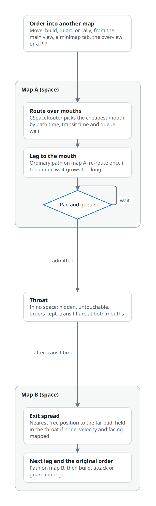

# Wormhole-linked maps

> Status: proposed, not implemented · 2026-10-11

**Each standard map is a space; wormholes are links between them.** A wormhole match is a world of two to four ordinary BAR or Zero-K maps loaded as [map spaces](spaces.md), joined by wormhole links whose mouths sit on passable ground in each map. Each map keeps its own heightmap, metal, terrain types, water level, gravity, wind, tidal, sky and features; nothing (fire, explosions, sensors, builder reach) crosses between maps except units passing through a mouth. The engine owns the mouths, queues, transit and routing ([links](spaces.md#links), [routing](spaces.md#routing-across-spaces)); games set the rules through link definitions and the `AllowUnitTransit` callin and draw the mouths and the interface. Maps that declare no spaces play exactly as today.

## Match shape

| Element | Behaviour |
|---|---|
| Maps | Two to four standard maps as spaces; sizes may differ; each loads its own archive, features, metal and map options ([declaring spaces](spaces.md#declaring-spaces)) |
| Wormholes | One to three links per pair of maps; two-way by default |
| Starts | Each team starts in one map (`StartSpace`); team games may put allies on different maps or opponents on the same one |
| Economy | One bank per team across all maps, as today; income differs by map |
| Victory | The game's existing rules (commander death, all units) over all maps |
| View | One map at a time on screen; switching, minimap and overview per [views](spaces.md#views) |

## Mouths

A wormhole is a `CLink` ([link data](spaces.md#link-data)); each end is a mouth.

| Part | Behaviour |
|---|---|
| Pad | Disc where units are admitted; units stop on it to queue |
| Spread area | Disc around the far pad where arrivals are placed; building-masked so it cannot be built over or walled |
| Mouth unit | A neutral Gaia unit per end, defined by the game (for example `wormhole_mouth`): model, effects, tooltip with queue length and rules; not targetable, not selectable as an order receiver; created by the game when the link is created |
| Knowledge | Mouth positions and their pairing are public: visible to all from the start, on the minimap and in the overview |
| State | Open by default; games may close and reopen links (`Spring.SetLinkState`) for capturable gates, timed openings or collapse |

## Placement and authoring

| Rule | Check |
|---|---|
| Pad on ground every allowed MoveDef can stand on, reaching the map's start positions and most metal spots | Validator: QTPFS reachability per allowed MoveDef from each pad to each start position |
| Spread area flat enough and free of map features | Validator; map features inside the spread area are removed at load |
| Ship-capable links only between pads in water deep enough for the allowed ship MoveDefs | Validator, from each map's height and sea level |
| Distance from start boxes | Mouths outside start boxes; the validator reports each start's path time to its nearest mouth, so team-game fairness can be checked |
| Symmetry | For 1v1 and symmetric team maps, matching mouth placement per side; reported, not enforced |
| Count | One link per map pair is a chokepoint; two or three give choices and stop single-mouth camping |

Authoring paths:

| Path | Who | Output |
|---|---|---|
| Wormhole map archive | Mappers | Small archive: `mapinfo.lua` with `spaces`, `links`, `linkRules`, `startSpaces`; `depend` on the member maps; a composite preview image |
| Lobby composition | Hosts | Start-script `[SPACEn]` and `[LINKn]` sections ([start script](spaces.md#start-script)); mouth positions from a game-side placer |
| Game-side placer | Games | Synced Lua at `Initialize`: candidate squares passable for the largest allowed MoveDef, outside start boxes, balanced path time per team; `Spring.CreateLink` for each pick; deterministic from the match seed |
| Placement tool | Mappers | The link placement dev widget ([tools](spaces.md#tools)) |

## Transit rules

| Rule | Proposed default | Alternatives |
|---|---|---|
| Who passes | Mobile units whose MoveDef is in `LinkRules::moveDefs` and whose footprint is within `maxFootprint`; aircraft only where `air = true`; structures, nanoframes and features never | Any unit; MoveDef classes only |
| Size classes | Three link classes defined by the game: small (bots, light vehicles), medium (most vehicles, hovers), large (all ground, ships where water allows) | Per-link footprint only |
| Transports | Pass with cargo only if every carried unit could pass alone (`EachMustPass`) | Cargo exempt, making transports the way to move heavy units |
| Admission | Unit on the pad, link open, cooldown expired, window budget covers its footprint area, `AllowUnitTransit` true | Entry on contact without stopping |
| Capacity | `capacityArea` footprint squares per `windowFrames` per direction | Unlimited; units per window |
| Queue | FIFO per direction; queued units hold around the pad; the mouth tooltip and the owner's overview show queue length and wait | Priority for some unit types |
| Transit time | `transitFrames` in the throat: not simulated, sensed, drawn or targetable, orders kept | Instant |
| Exit | Nearest free position to the far pad inside the spread area, facing away from the mouth; velocity and orientation mapped ([frame mapping](spaces.md#frame-mapping)) | Fixed exit slots |
| Contested exit | Enemy units in the spread area do not stop arrivals; arrivals take the nearest free position and fight. With no free position, the unit waits in the throat (`HoldUntilFree`); no telefrag | Exit protection (short shield or cloak by game rule); refuse admission while the exit is held |
| Cooldown | A unit cannot re-enter the link it left for `cooldownFrames` | Mouth-wide cooldown |
| Direction | Two-way | One-way links (`oneWay`) for asymmetric maps |
| Aircraft | Fly into the pad's air cylinder; exit at the mapped altitude; same capacity | Air-only links; no air transit |
| Teleporter units | Zero-K's own teleporters move units within one map and never chain across mouths unless a game rule allows | — |

All defaults live in each game's link rule definitions, not in the engine.

## Orders and pathing in practice

Routing is the engine's ([route search](spaces.md#route-search)); this is how play uses it.

| Player action | Result |
|---|---|
| Right-click on another map's minimap, in the overview, or in a PiP of another map | Move order in that space; the selection walks to the cheapest mouth, queues, transits and continues |
| Shift-queued orders across maps | Each order keeps its space; the route is computed when the order starts |
| Build order placed on another map | The builder routes there and builds in range; the build preview draws in the view of the target map |
| Factory rally to another map | New units leave with the route |
| Guard or attack a unit that transits | The guard or attacker follows through the same or a cheaper mouth |
| Area commands | Within the map they are drawn on |
| Fifty units to another map | All share one route graph result; the queue meters them; units re-route once if a mouth's wait exceeds another route by a margin |
| Command line drawing | In the view map: the path to the mouth, then a mouth marker with the destination map's name and an ETA |

Path requests from Lua or AIs that cross maps use `Spring.RequestRoute`; `Spring.RequestPath` stays within one map.

## Builders and economy per map

| Area | Behaviour | Where it lives |
|---|---|---|
| Metal | Each map's own metal map and extractor radius; mex spot lists per map | Engine per space; BAR's `luarules/gadgets/map_metal_spot_placer.lua` and Zero-K's spot finders run once per space |
| Bank | One per team across maps | `CTeam`, unchanged |
| Wind | Each map's wind range and its own wind changes; overridable per space | Engine `EnvResourceHandler` per space; BAR's `luarules/gadgets/unit_windmill_control.lua` reads the generator's space |
| Tidal | Per map | Engine per space; BAR's `luarules/gadgets/game_custom_map_tidal.lua` per space |
| Water level and lava | Per map | Sea level per space; BAR's `map_waterlevel.lua` and `map_lava.lua` act on their space only |
| Gravity | Per map; ballistic aim uses the shooter's space | Engine per space |
| Geothermal, reclaim | Map features belong to their map | Engine |
| Expansion | Builders route through mouths; area-mex and area-reclaim stay on the clicked map | Router, area commands |
| Overview | Income and storage contribution per map | Game UI, summing by `Spring.GetUnitSpace` |

## Fog and scouting across links

| Rule | Behaviour |
|---|---|
| LOS and radar | Per map and ally team; nothing seen through a mouth |
| Mouths | Always visible, with queue length shown only to the queue's owner |
| Transit flares | An arrival or departure flashes at the mouth; seen by anyone with LOS on that mouth |
| Far-side view | None by default; `VisionRule::Window(radius)` gives the owner of a unit on the pad a small LOS at the far mouth, as a game option |
| Scouting | Send units through; radar ghosts and last-seen buildings stay per map |
| Overview | Each map shows only what the alliance has seen there; never-scouted maps show terrain and mouths only |

## Long-range weapons near mouths

| Case | Behaviour |
|---|---|
| Nukes, long-range artillery, missiles | Never leave their map. BAR's nuke range (`units/ArmBuildings/LandDefenceOffence/armsilo.lua`) exceeds any shipped map and long-range plasma covers large parts of one, so a mouth inside such coverage is a hard chokepoint |
| Anti-nukes and other interceptors | Cover their own map only; each map needs its own coverage |
| Exit camping | Artillery and static defences covering a far mouth are strong. Mitigations, all game or map choices: several mouths per pair, spread area, mouths in low ground with cover, exit protection by rule |
| Unit in the throat | Untargetable; missiles tracking it lose their target |
| Cross-map strikes | Only as explicit game rules (for example a gate-launched strike that spawns a projectile at the far mouth); the engine never carries a projectile through a link |

## AI

| AI | Needs |
|---|---|
| Any AI, unchanged, one-map match | Nothing |
| Any AI, unchanged, wormhole match | Sees only its context space (space 0); its team must be confined to one map by the game, or the lobby refuses ([open decisions](spaces.md#open-decisions)) |
| CircuitAI (BARb, Zero-K) | Per-space terrain analysis and area graph; threat and economy maps per space; link graph and queue state from the callback; staging at mouths as an intention; per-space defence of mouths it owns |
| Lua AIs (BAR's STAI and others) | `Game.spaces`, `Spring.GetUnitSpace`, `Spring.GetLinks`, `Spring.RequestRoute`, `UnitEnteredSpace` |
| Fairness | AIs read only their alliance's knowledge per space |

## Interface

| Element | Behaviour |
|---|---|
| Map switcher | A strip of map tabs with owner colours, alerts and unit counts; hotkeys for next and previous map; double-tap of a control group switches to its map |
| Minimap | The view map; its tab strip switches maps |
| Overview | Maps as nodes with `$minimap:<spaceID>` images, mouths as edges with queues, the alliance's known strength and income per map; right-click sends the selection |
| Picture-in-picture | BAR's `luaui/Widgets/gui_pip.lua` switched to `gl.RenderSpace` to watch another map |
| Selection panel | Groups units by map and lists units in transit |
| Alerts | One alert per engagement on another map; markers carry their map |
| Mouth tooltip | Destination map, rules, queue length and wait |
| Spectators | Same switcher; auto-camera picks the map with the most combat |

## Map making and lobby

| Area | Behaviour |
|---|---|
| Member maps | Ordinary maps, unchanged and still playable alone |
| Wormhole map archive | Declaration only; downloads its member maps through `depend` |
| Lobby list | Shown as a map with the composite preview; space-aware lobbies show each member map and the links |
| Start boxes | Per map: start-script ally-team boxes gain `StartSpace`; BAR lobby, Chobby and SPADS need a map selector in their start-box editors |
| Lobby composition | Pick two to four maps and a link preset; the game's placer places mouths at start |
| Replays | Start script carries the declaration; replays rebuild the world |

## What Zero-K and BAR change

| Area | Change |
|---|---|
| Map-size assumptions | 117 BAR Lua files read `Game.mapSizeX` or `Game.mapSizeZ`, which describe space 0; camera, minimap, start setup, spot finders, random placement and scenario tools switch to `Game.spaces[Spring.GetViewSpace() + 1]` or the unit's space |
| Ground and unit queries | 148 BAR Lua files call `Spring.GetGroundHeight`; 218 call position-keyed queries (ground, units in area, LOS at a position, build tests, screen rays). Correct in their callin's [context space](spaces.md#context-space) without edits when they act on one unit or the view; gadgets that loop over the whole map in `GameFrame` need a loop over spaces |
| Map gadgets | Metal spots, lava, water level, tidal and wind per space |
| Mouths | Mouth unit definitions, effects and tooltip; link rule presets (small, medium, large) |
| Placer | Game-side mouth placer for lobby-composed matches |
| Terraform | Zero-K terraform acts in its space through the context; no cross-map terraform |
| Balance | Interceptor coverage per map; exit camping; link capacity tuned against unit costs |
| UI | Map switcher, minimap tabs, overview, PiP, selection grouping, alerts |
| AI | As above |

## Order of work

Each stage needs the [spaces stage](spaces.md#staged-plan) named.

| Stage | After | Build | Go / no-go |
|---|---|---|---|
| W0. Two maps, scripted link | S4 | A BAR test branch: two BAR maps as spaces, one link from the start script, mouth unit, default rules | One unit, fifty mixed units, transport with cargo, build order across, guard of a transiting unit, contested exit: no unit stuck at a mouth after a set time; queue throughput as configured; orders and selection preserved; two-client game without desync |
| W1. Long reach | W0 | Nukes, long-range artillery, radar and jammers placed beside a mouth | Nothing reaches the other map; interceptors cover only their own map; a unit in the throat cannot be hit |
| W2. Interface | S5, W0 | Map switcher, minimap tabs, overview, PiP, alerts in the BAR branch | Captures at RTS height and close zoom on both maps; switching under a second; user review |
| W3. Economy and map gadgets | W0 | Metal spots, wind, tidal, water level per map | Generators earn by their map's wind and tidal; mex spots match each map played alone |
| W4. AI | S6, W0 | CircuitAI and STAI aware of spaces and links | AI-vs-AI games on two- and three-map worlds finish without stalls at mouths; AIs expand to other maps; no reads of unseen maps |
| W5. Archives and lobby | S7 | Wormhole map archive, lobby start boxes per map, lobby composition with the placer | A wormhole map downloads, starts from the lobby and replays |
| W6. Zero-K | W0–W4 | Same in Zero-K, including terraform and teleporters | Zero-K's test scenarios and AI games pass on a two-map world |

Stop after W0 if groups stall at mouths in ways queues and re-routing cannot fix. Stop after W2 if players cannot follow two fronts with the switcher, overview and alerts.

## Open questions

| Question | Options | Suggestion |
|---|---|---|
| Transit | Instant / time in the throat | Time in the throat, short |
| Capacity | Unlimited / footprint area per window | Footprint area per window |
| Transports and size classes | Cargo checked / cargo free | Cargo checked |
| Aircraft | Through mouths that allow air / never between maps | Through mouths that allow air |
| Exit camping | Exit regardless / hold when blocked / exit protection | Hold only when no free position; protection as a game option |
| Vision through mouths | Flares only / small far-side window | Flares only |
| Bank | One per team / per map | One per team |
| Long-range weapons | Confined to their map / scripted cross-map strikes | Confined; scripted strikes per game |
| Mouth state | Always open / capturable gates / timed | Always open; others as game options |
| Mouth knowledge | Public / discovered by scouting | Public |
| Map count | Two to four / more | Two to four until memory and AI are measured |
| Lobby composition | Archive only / also lobby-composed | Archive first; composition after W5 |

The stitched-atlas route (several maps copied side by side into one SMF with an impassable band and region clipping rules) was rejected: it shares one gravity, water level, terrain-type table and splat set across maps, pays memory for the band and padding, and depends on clipping every reach at a seam; it is acceptable only as a throwaway gameplay prototype on today's engine.
