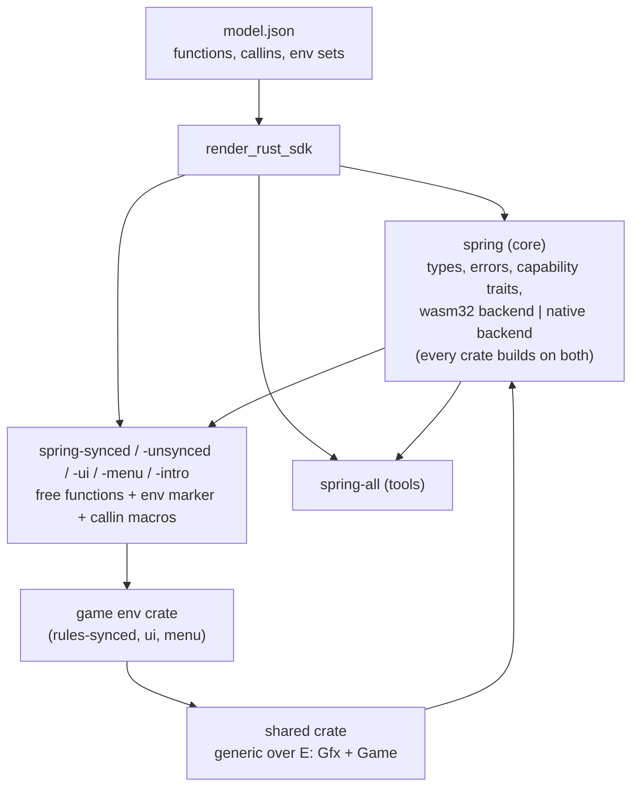

# Rust SDK: one crate, per-environment surfaces

**2026-10-17**

Status: proposal. Docs only; no code changed. Counts below were taken at `rust-wip` `d56809ab2d` from `rts/wasm/generated/model.json` and `rts/wasm/generated/sdk/core_environments.rs`.

**Summary.** NativeInterface is already one semantic API, and the Wasm adapters are generated from it ([architecture](recoil_wasm_architecture.md), "Rust module API"). The Rust layer is still split in two. `spring`, the Wasm guest SDK, gates almost every module on `target_arch = "wasm32"`. `spring-native` is a different API: it uses handles instead of free functions, raw `i32` IDs instead of typed IDs, a `NativeModule` trait instead of exported callins, and its own typed RmlUi data model. This proposal does three things:

- It makes `spring` the one SDK, with the backend chosen by target: Wasm imports on `wasm32`, `spring-native-sys` elsewhere.
- It moves the per-environment namespaces that codegen already emits into their own crates: `spring-synced`, `spring-unsynced`, `spring-ui`, `spring-menu`, `spring-intro`, plus `spring-all` for tools. Code in one environment then cannot name another environment's calls.
- **Target and environment are independent.** Every environment crate, `spring-all` included, builds for both `wasm32` and native. Whether a module ships as Wasm or native is a per-module build choice, for example a native UI with Wasm rules. It never follows from its environment.
- **The crates are generated, not hand-maintained.** The generator writes them from the function and environment sets in `model.json`, the same way it writes today's SDK; only the core types and the shared typed layers are written by hand.
- It generates sealed capability traits from the environment sets, so that shared crates are generic over the environment and the check reaches through them.

Ship Game's menu, built both ways from one source, is the gate before the menu goes native (Ship Game's [LAN proposal](/home/gajop/projects/spring-projects/ship-game.sdd/docs/proposals/multiplayer/lan.md), items U1 and N1).

No dedicated doc existed before this one. Earlier docs state the goal without a design:

- [Execution Environments](recoil_wasm_execution_environments.md), "Native versus Wasm source experience";
- [Architecture](recoil_wasm_architecture.md) §4;
- the optional `spring-module/` façade in the [Implementation Plan](recoil_wasm_implementation_plan.md) layout.

This doc extends them and does not restate them.

## Current state

### Crates (`rust/crates`)

| Crate | Role today | Fate |
|---|---|---|
| `spring` | Wasm guest SDK, `no_std` with an `alloc` feature. Hand-written fast helpers (`units_query.rs`, `rml_ui.rs`, …). Generated Core-ABI imports and owned wrappers come in through `build.rs` from `rts/wasm/generated/sdk/*`. The flat surface re-exports every function. `spring::{rules_synced, rules_unsynced, gaia_synced, gaia_unsynced, ui, menu, intro}` are per-environment re-export modules. Most modules are `#[cfg(target_arch = "wasm32")]`; a native build of `spring` contains only `cus`, `callback`, constants and types. | Becomes the core crate: types plus both backends |
| `spring-native` | Safe façade over `spring-native-sys`. `NativeInterfaceRef` handle methods (`interface.units_query().get_team_units(0)`), `Result<_, Error{code,message}>`, `sys::Float3` in results, `NativeModule` trait plus `export_module!`, typed `RmlDataModel::bind::<T>()`. Depends on `spring` only for `cus`. | Compatibility shim over `spring-all`, then removed |
| `spring-native-sys` | bindgen over `NativeInterface.h` | Unchanged; becomes the native backend's only dependency |
| `spring-native-codegen`, `spring-api-codegen` | libclang model plus renderers: `render_core_native.rs` for native Rust, `render_core_wasm_*.rs` for the guest SDK, host adapters and registry. `spring-api-codegen` is the facade. | One `render_rust_sdk` renderer emits both backends (below) |
| `spring-addons` | Gadget, widget and unsynced-addon handlers, `export_rules_gadgets!` / `export_ui_widgets!` / `export_rules_unsynced_addons!`, which also emit `SPRING_ENV_MASK` | Generic over the environment; builds natively |
| `spring-skirmish-ai(-sys)` | Native C AI interface, not NativeInterface | Out of scope |
| `spring-wasm-typed-host` | Only a stale `target/` directory | Out of scope |

### Environment boundaries

- **Per-function environment sets come from the model.** `spring-native-codegen/src/lua_loader.rs` derives `environments` for each function from the Lua loaders, and `model.rs` rejects mutating functions in unsynced environments. In the model, 1,425 functions fall into only **9 distinct environment sets**, and 132 callins into 10. Rules and Gaia always appear together.

  | Environment set | Functions | Main families |
  |---|---|---|
  | all 7 | 69 | vfs, math_extra, debug_input, encoding |
  | all except intro | 3 | system_control |
  | in-game: rules, gaia (synced and unsynced) and ui | 483 | unsynced_ctrl, units_info, game, features |
  | synced (rules, gaia) | 229 | unit_control, feature_control, move_ctrl, terrain_control |
  | unsynced and ui | 187 | display, unit_rendering, input, unsynced_read |
  | unsynced, ui, menu and intro | 266 | gfx, vfs |
  | unsynced, ui and menu | 184 | rml_ui |
  | menu and ui | 3 | vfs |
  | unsynced, ui and intro | 1 | system_control |

  Family names do not tell you the environment. For example, `unsynced_ctrl::set_unit_no_draw` is legal in synced code, because the synced Lua state also loads `LuaUnsyncedCtrl` (`rts/Lua/LuaHandleSynced.cpp:533`). Surfaces must therefore be cut by environment set, not by NativeInterface header.

- **The UI surface is the unsynced surface plus 3 VFS calls** (1,196 against 1,193). What separates UI from unsynced is the host's LOS-filtered reads (`WasmUiVisibility`) and the callins it receives, not the call surface.

- **Host backstop for Wasm.** `rts/WasmInterface/core/host/WasmCoreRegistry.h` gives every import an `environmentMask`, and `WasmCoreRegistryPolicy.h` adjusts the hand-written ones. The guest must export `SPRING_ENV_MASK` (`WasmCoreValidation.cpp`), and `WasmCoreHost.cpp` requires it to equal the manifest's environment.

- **Native has no per-function backstop.**
  - The menu and intro get a family-level table: `WasmStandaloneEnvironment::Create` fills in only the menu's families and leaves the rest null.
  - In-game native modules receive the whole `NativeInterface`.
  - Native modules export no environment marker.

- **Entry points differ by backend.**
  - Wasm: one generated `export_<callin>!` macro per callin (`core_callins.rs`), which exports `spring:callin/<name>`; plus `export_callin_scratch!`, `export_callback_dispatch!` and `export_environment_mask!`.
  - Native: `NativeModuleApiVersion` and `InitializeNativeModule` from `export_module!`, and C symbols that `NativeInterfaceEventClient::LoadSymbols` resolves.

### How Ship Game uses it (`/home/gajop/projects/spring-projects/ship-game.sdd/wasm-src`)

| Crate | Environment | `spring` use |
|---|---|---|
| `rules-synced` | rules synced | Flat `spring::*` and `spring::rules_synced::*` mixed; `spring-addons` gadgets; `export_core_cus!`; `export_allow_*!` |
| `rules-unsynced` | rules unsynced | Flat and `spring::rules_unsynced::*`; `fx`, `fx-recoil` |
| `ui` | UI | Flat `gfx`, `camera`, `selection`, `rml_ui`; `export_ui_widgets!` |
| `menu` | menu | `use spring::{gfx, rml_ui as rml, system_control}`. Flat RmlUi handle calls (`data_model_bind_{int,bool,string,rows,event}`, `data_model_set_*`, `data_model_current_value`); its own `export_callback_dispatch!(dispatch)` and per-callin exports. Every module sits behind `cfg(target_arch = "wasm32")` (`menu/src/lib.rs:7-11`) |
| `shipcore` | shared | `spring` is optional behind feature `engine`. With it on, the build includes unsynced and UI calls (`visibility_view.rs`, `region_sky.rs`); rules-synced turns it on too, though it only needs `options` and `drawn` |
| `fx-recoil` | unsynced or UI | Picks the environment with a Cargo feature: `use spring::rules_unsynced as env` or `use spring::ui as env` (`crates/fx-recoil/src/lib.rs:35-38`) |
| `fx`, `launch` | pure | No `spring` |

Cross-environment use today. Each one compiles, and the host accepts it because the import is legal in both environments:

- `ui/src/navigation.rs:4` and `ui/src/nav_debug.rs:10` use `spring::rules_unsynced::gfx` from the UI module.
- `ui/src/hud/selection.rs:338` hand-rolls `#[unsafe(export_name = "spring:callin/command-notify")]`, because the widget SDK lacks CommandNotify.

The flat surface makes every environment's calls nameable everywhere. The per-environment modules only help where people use them.

The engine crates are pinned in two places:

- `wasm-src/Cargo.toml` takes `spring` and `spring-addons` from git `gajop/spring-rust` branch `rust-wip`, with `features = ["alloc"]`.
- The gitignored root `/home/gajop/projects/spring-projects/ship-game.sdd/.cargo/config.toml`, written by `just setup-dev-engine`, patches them to the local `spring-bar` paths.

`wasm-src/.cargo/config.toml` sets `[build] target = "wasm32-unknown-unknown"`, and only for that target sets the cfgs `spring_gfx_readback` and `spring_vfs_range`. The release profile has `panic = "abort"`.

### Where the two APIs differ

| Concern | `spring` (Wasm) | `spring-native` | Unified rule |
|---|---|---|---|
| Call style | Free functions | Methods on `NativeInterfaceRef` sub-handles | Free functions. The native backend keeps the interface pointer in a process global set by `InitializeNativeModule` |
| IDs | `impl Into<UnitId>` / `TeamId` | `i32` | Typed IDs |
| Lists | `_into(&mut [T]) -> BufferFill` (no_std) plus owned `Vec` under `alloc` | `Vec<T>` only | Both forms on both targets. Natively, `_into` copies from the result scratch with the same truncation and `BufferFill` semantics |
| Strings out | Length-prefixed bytes, `String::from_utf8` (invalid UTF-8 is an error) | `CStr::from_ptr(..).to_string_lossy()` (stops at NUL, lossy) | One rule from the model: length-delimited on both, with the same invalid-UTF-8 handling. The native backend must not use `CStr` where the result has a length. [Core ABI contract](impl/core_abi_contract.md) goal 7 keeps byte semantics |
| Errors | `ApiError { code }`, `ErrorCode` | `Error { code, message }` | `spring::Error { code: ErrorCode }`; `message()` returns `Option`, which only native fills |
| Records | Generated semantic structs | Some `sys::*` records (`sys::Float3`) | Semantic structs only, as [API & Code Generation](recoil_wasm_api_codegen.md) "Public Rust values" requires |
| Callbacks | `RetainedCallback` ids routed through the game's `export_callback_dispatch!` | Rust closures (`bind_event<F>`) | Closures on both. On Wasm the SDK keeps the closure table and owns the dispatch export |
| RmlUi data model | Flat handle calls generated from the model | Hand-written typed `RmlDataModel`, `RmlDataVariable<T>`, `bind_rows`, `RmlValueRef` | Generated flat calls on both, with one typed layer written once on top of them in backend-agnostic code. Native `rml_ui.rs` is retired |
| Callins | `export_<callin>!(handler)` per callin | `NativeModule` trait, `export_module!` | Per-callin macros on both; per-environment crates only export the callins in their set |
| Module marker | `SPRING_ENV_MASK` export | None | Both export it, and the native loader checks it |
| Unverified API | Withheld from production imports | `unverified-api` feature | `unverified-api` on both targets, so a call cannot compile natively and fail on Wasm |
| Panics | Trap; module unloaded | `catch_unwind` at the FFI boundary, returned as an error | Open question 4. Native needs `panic = "unwind"` |
| Threads | One thread | Any thread can hold the pointer | Engine calls are allowed only on the engine thread. The native backend checks a thread-local flag that `InitializeNativeModule` sets and returns `ErrorCode::InvalidState` off-thread |

## Design

### 1. One SDK, backend chosen by target

- **`spring` (core)** holds:
  - types, IDs, errors, constants (`gl`, `cmd`), logging macros and `cus`;
  - the generated capability traits (§2);
  - both backends behind `cfg(target_arch = "wasm32")`.

  Game code never calls a backend directly. The backend modules are `#[doc(hidden)] pub mod __backend`, and a CI grep forbids that path outside the SDK crates.
- **One renderer.** `spring-api-codegen` gains `render_rust_sdk`, which emits each function's public signature once from the semantic model, with two bodies:
  - wasm32: today's owned wrapper over the Core-ABI import (`render_core_wasm_owned_guest.rs` and the borrowed, variable and dynamic renderers);
  - native: today's `render_core_native.rs` body, changed to the unified types (typed IDs, semantic records, `_into`, the string rule).

  Signatures are identical by construction. The test is that `cargo public-api` for each environment crate shows no diff between `--target wasm32-unknown-unknown` and the host.
- **Hand-written helpers** in `spring/src/*.rs` (for example `ground_heights` and the borrowed unit queries) get classified:
  - (a) generate it;
  - (b) rewrite it over public generated functions, which makes it backend-agnostic;
  - (c) keep a Wasm fast path, but only alongside a native twin and a unit test that compares the two.

  The generator's report lists each helper's class.
- **`std` and `alloc`.** The native backend uses `std` internally (panic hook, thread flag). The public `alloc` feature means the same thing on both targets.
- **Entry points.** Each environment crate provides `spring_<env>::module! { init: …, shutdown: … }`:
  - Natively it emits `NativeModuleApiVersion` and `InitializeNativeModule`. These store the interface pointer, set the engine-thread flag and install the panic hook.
  - On Wasm it emits nothing beyond the marker.

  Per-callin `export_<callin>!` macros expand to the `spring:callin/<name>` export on Wasm and to the C symbol that `NativeInterfaceEventClient` loads natively, with the conversion between query/result records and semantic types. `export_callin_scratch!` does nothing natively. `spring-addons` handlers use these macros, so gadgets, widgets and the menu are written once.
- **RmlUi.** The generated flat calls (`context_create_data_model`, `data_model_bind_*`, `data_model_set_*`, `data_model_set_rows`, `data_model_current_value`, the event-listener calls) become the shared surface. `spring::rml::DataModel` (typed `bind::<T>`, `bind_rows`, closures for `bind_event`) is written once over that surface and replaces both the native typed layer and game-side wrappers such as Ship Game's `menu/src/model.rs`.
  - Closures on Wasm: the SDK maps `RetainedCallback` ids to boxed closures and exports `spring:callback/dispatch` itself.
  - The listener transports registered by hand in `WasmCoreRmlUiBindings.cpp` keep their Core signatures.
- **Migration.**
  1. The new crates ship alongside the old surface. The flat `spring::*` surface stays behind a `legacy-flat` feature for one migration window.
  2. `spring-native` becomes a shim: `NativeInterfaceRef` handle methods that call `spring-all`, plus a `NativeModule` adapter, so SpringBoard's native crate (`/home/gajop/projects/spring-projects/SBC.sdd/native`, about 190 files) keeps building.
  3. SpringBoard migrates to `spring-all`; then the shim and `legacy-flat` are deleted.

### 2. Per-environment surfaces enforced at compile time

**Recommendation: per-environment crates for environment code, and generated sealed capability traits for shared code.** The environment marker types live only in the environment crates. The host masks stay as the runtime backstop.

- **Environment crates.**
  - Each of `spring-synced` (rules and gaia), `spring-unsynced` (rules and gaia), `spring-ui`, `spring-menu` and `spring-intro` re-exports the core types. It also exposes the functions in its environment set as free functions, grouped by family as `core_environments.rs` already does (`spring_ui::gfx::begin_end`), plus only the callin macros its environment receives.
  - The crate defines its marker type (`spring_ui::Ui`) and implements the capability traits that its set includes. It also exports `SPRING_ENV_MASK` itself, so the environment is chosen by the dependency and not by a macro the game must remember.
  - Rules and Gaia share a crate. The marker carries the mask for both, and the host changes from "marker equals the manifest environment" to "the marker contains the manifest environment".
- **Migration costs one line per crate.** `spring = { package = "spring-ui", … }` keeps the `spring::gfx::…` paths in game code, and the compiler then reports every cross-environment use. In Ship Game that is `ui/src/navigation.rs:4` (`spring::rules_unsynced::gfx` → `spring::gfx`).
- **Capability traits.** There is one sealed trait per environment set (`Common`, `Game`, `SyncedCtrl`, `Local`, `Render`, `Rml`, plus names for the three small sets). Each has the set's functions as associated functions with default bodies that call the backend. The generator fails on a new set that has no name.
  - Shared code is generic: `fn draw<E: Render + Game>(…) { E::begin_end(…) }`. The environment crate instantiates it with its own marker: `fx_recoil::draw::<spring_unsynced::Unsynced>()`. A synced crate calling it fails with "the trait bound `Synced: Render` is not satisfied".
  - The check therefore reaches into shared crates with no runtime token and no threaded context value; monomorphisation makes it free.
  - `fx-recoil` replaces its `ui` feature with a type parameter. `shipcore`'s engine half becomes generic, or splits into a synced-safe part and an unsynced part, so rules-synced stops compiling camera, player and unsynced-ctrl calls.
  - Pure crates (`fx`, `launch`, and `shipcore` without `engine`) depend on nothing, or only on core types.
- **Sealing.** The traits require `spring::__private::Sealed`. Accidental misuse cannot compile; a deliberate bypass has to spell `__private`, which is easy to see in review and CI greps for it.
- **`spring-all`** builds on both targets, like every other crate. Its marker implements every trait and exports the union of callins. It is for editors and tools: SpringBoard today mixes `synced_ctrl()`, `unsynced_ctrl()`, `gfx()`, RmlUi and input in one module. It makes no sync guarantee (open question 3). On Wasm it needs one engine addition: a tool environment whose import mask is the union, loaded only for tool and editor launches. Natively, the loader gives an all-environment module the full table under the same launch rule.
- **Two environment crates in one artifact** are a link error: both export the `#[no_mangle]` marker symbol. A library crate that depends on an environment crate is therefore unusable from another environment, which forces shared crates onto the traits.
- **Host backstop, unchanged for Wasm.** Import masks plus `SPRING_ENV_MASK` still reject a module whose imports leave its environment, for example through the `__private` bypass or a stale build. Two additions:
  - a build-time import audit: a small tool that checks a built `.wasm`'s imports against `WasmCoreGeneratedRegistry.h` for its declared environment, so the game build fails before the engine does;
  - per-function native tables: each environment gets a generated `NativeInterface` table whose out-of-environment entries return `NotAvailable`, and the native loader checks the module's marker.

#### Options considered

| Option | Verdict |
|---|---|
| **Cargo features per environment on one crate, `compile_error!` on conflicts** | Rejected. Ship Game builds all four cdylibs with `cargo build --workspace`, and Cargo unifies `spring`'s features across them, so `synced` + `ui` would always conflict. Each environment would need a separate cargo invocation or workspace. Shared crates would also see the union. |
| **Runtime capability tokens (`&Synced` passed to every call)** | Sound, but every one of the hundreds of Ship Game call sites and every helper would need a context threaded through. Marker *types* get the same guarantee for shared code without values; environment code keeps free functions. |
| **Today's namespaces inside one crate (`spring::rules_synced::…`)** | Rejected. Nothing stops synced code from naming `spring::ui::…` or the flat surface, and it already happens (`ui/src/navigation.rs:4`). |
| **Per-environment crates only, shared code depending on an environment crate** | Shared crates would have to pick one environment. `fx-recoil` serves unsynced and UI, `shipcore` serves three. Kept for environment code; traits cover shared code. |

#### Codegen

- `model.json` already carries `environments` for every function and callin. The renderer groups functions by set, then emits:
  - the traits into `spring`;
  - one generated `src/generated.rs` per environment crate, holding the free functions as one-line calls through the marker's trait (`<Ui as Render>::begin_end(…)`), the marker, the trait impls, the mask and the callin macros;
  - `spring-all`.
- Generated sources stay committed and snapshot-checked, as the Wasm SDK in `rts/wasm/generated/sdk` and `spring-native/generated` are today.
- `generation-report.json` gains a count of functions per environment set and per environment crate. Those counts must equal the host registry's masks, which is checked by test.

## Verification

1. **Ship Game menu, one source, two builds (the gate for U1 → N1).**
   - Remove the `cfg(target_arch = "wasm32")` gates in `/home/gajop/projects/spring-projects/ship-game.sdd/wasm-src/menu/src/lib.rs`.
   - Build `shipgame-menu` for `wasm32-unknown-unknown` (to `menu/WasmMenu/shipgame-menu.wasm`) and for the host (to `menu/WasmMenu/libNativeMenu.so`).
   - Code that only the native menu has (networking) is the only `cfg` left in the menu crate.
   - Native builds need a profile with `panic = "unwind"`, and the `spring_gfx_readback` / `spring_vfs_range` cfgs set for the host target too (`wasm-src/.cargo/config.toml`).
   - Required checks:
     - `cargo test -p launch` (`wasm-src/crates/launch/tests/parity.rs`) passes. It is host-only and backend-independent.
     - A checked-in tour file, which does not exist today, runs through `/home/gajop/projects/spring-projects/ship-game.sdd/tools/menu.py --offscreen --tour FILE --out DIR` against each build. `menu.py` gains `--native`, which packages `libNativeMenu.so` (when both are present, `LuaMenuController::InitWasmMenu` prefers the native module).
     - Tour screenshots match between builds within a stated tolerance.
     - The start script that each build passes to `system_control::reload` for the same tour steps is byte-identical, and matches `tools/launch_script.py`.
2. **Compile-fail tests.** A `rust/tests/env-surfaces` crate uses `trybuild`, with pinned toolchain and normalized stderr:
   - a synced crate naming `spring_synced::gfx` or `rml`;
   - UI calling `unit_control::create_unit`;
   - menu exporting `export_game_frame!`;
   - a synced instantiation of a `<E: Render>` helper;
   - implementing a capability trait outside the SDK;
   - an environment crate built for one target only (each must pass on both).

   A CI script expects the link of two environment crates into one cdylib to fail, which trybuild cannot express. Matching pass cases cover every environment.
3. **Surface identity.** For each environment crate and each target, a generated smoke crate references every function and callin macro. `cargo public-api` must show no difference between the wasm32 and host builds.
4. **Wasm import audit.** Ship Game's `just build` runs the audit on all four modules. A fixture module with an out-of-environment import must fail it.
5. **No stubs and parity** ([No Stubs Plan](recoil_wasm_no_stubs_plan.md), [Parity & Testing](recoil_wasm_parity_testing.md)):
   - The native backend is generated, so `check_native_stubs.py` and the generated mutants keep covering the C++ implementations it calls.
   - The "Codegen prevention" rule applies to both targets through `unverified-api`.
   - Parity & Testing §3, the native ↔ Wasm signature gate, is met by construction and checked by item 3.
   - §5/§7 runtime parity becomes one parity guest crate built both ways, replacing the separate native parity crate and Wasm probe. Results are compared per environment against the matching Lua role.
   - New environment-guard entries in the native tables are reviewed exemptions (they return `NotAvailable`), not stubs.

## Work items

| # | Item | Effort | Depends on |
|---|---|---|---|
| W1 | `render_rust_sdk`: one signature per function, wasm32 and native bodies; unified IDs, records, errors, `_into`, string rule; engine-thread flag | L | — |
| W2 | Classify and port the hand-written helpers in `spring/src` (generate, rewrite over generated calls, or fast path with a native twin and a test) | M | W1 |
| W3 | Environment sets → sealed capability traits; generate `spring-{synced,unsynced,ui,menu,intro,all}` with markers, masks and callin subsets; `legacy-flat` feature | M | W1 |
| W4 | Entry points: `module!`, native per-callin macros, `spring-addons` generic over the environment and native-buildable | M | W1, W3 |
| W5 | RmlUi: flat calls on both targets, SDK-owned closure dispatch on Wasm, one typed `rml::DataModel`; retire `spring-native/src/rml_ui.rs` | M | W1, W4 |
| W6 | Host: marker contains the environment (rules and gaia share a crate); native loader checks the marker; per-environment native tables | S | W3 |
| W7 | Tests: trybuild compile-fail, link-conflict script, per-environment smoke crates, `cargo public-api` diff, Wasm import audit tool | M | W3 |
| W8 | Ship Game migration: dependency renames, fix `ui/src/navigation.rs` and `nav_debug.rs`, make `fx-recoil` and `shipcore`'s engine half generic, drop the hand-rolled CommandNotify export, publish the new crates to the `gajop/spring-rust` mirror and add them to the `setup-dev-engine` patch | M | W3, W4 |
| W9 | Menu dual build and gate: native profile and cfgs, checked-in tour, `menu.py --native`, screenshot and start-script comparison. **Completes U1.** | M | W5, W8 |
| W10 | `spring-native` shim over `spring-all`; migrate SpringBoard's native crate; delete the shim and `legacy-flat` | M | W3, W4 |
| W11 | One parity guest built both ways; per-environment runtime parity | M | W1, W3 |

Order:

1. W1 → W3 → W4 → W5. W6 and W7 can run in parallel once W3 lands.
2. W8 → W9: the menu gate, so N1 can start.
3. W10 and W11 last; they are not on the menu's critical path.

## Risks

- **Native hot paths.** The native backend converts at the public-signature level. Wasm fast paths in hand-written helpers lean on Core-ABI layout. Class (c) helpers need a measured native twin.
- **Link-conflict detection.** Whether `#[no_mangle]` markers in two rlibs reliably collide in a cdylib, on all three platforms and with LTO, is unproven. W7 checks it. The fallback is a build-script check over `cargo metadata`.
- **trybuild drift.** Diagnostics change with the toolchain. Pin the toolchain and assert on the error code and trait name, not the full text.
- **Feature unification.** `alloc` and `unverified-api` must mean the same thing on both targets, or code compiles in one build only.
- **SpringBoard churn.** About 190 files use handle-style calls. The shim keeps them building; the migration can be partly mechanical.
- **Synced native modules** get the same API but not Wasm's determinism (NaN canonicalization, fixed memory). This proposal targets native menus and tools. Native in-game modules keep today's status.
- **`panic = "abort"`** in Ship Game's release profile would let a native menu panic take the engine down.

## Open questions

1. **Crate names.** Should the core stay `spring` (keeps Ship Game's git pin and SpringBoard's paths stable), with environment crates `spring-<env>`? Or should the core be renamed `spring-core` and `spring` become a re-export?
2. **Rollout order.** Every environment adopts the crates on both targets eventually, since target and environment are independent. Which first: the menu (the native-menu gate), then UI, then rules?
3. **`spring-all` in multiplayer.** Should the engine refuse an all-environment module, Wasm or native, when `IsHost` has more than one player, or only warn?
4. **Panic policy.** Should a native callin panic unload the module, as a Wasm trap does, or be reported and continue?
5. **Strings.** Should results with invalid UTF-8 be an error on both targets (today's Wasm behaviour), or should the SDK return bytes for the calls the model marks as raw?
6. **Callbacks.** Should the menu's manual `export_callback_dispatch!` stay available next to SDK-owned closures, or be removed?
